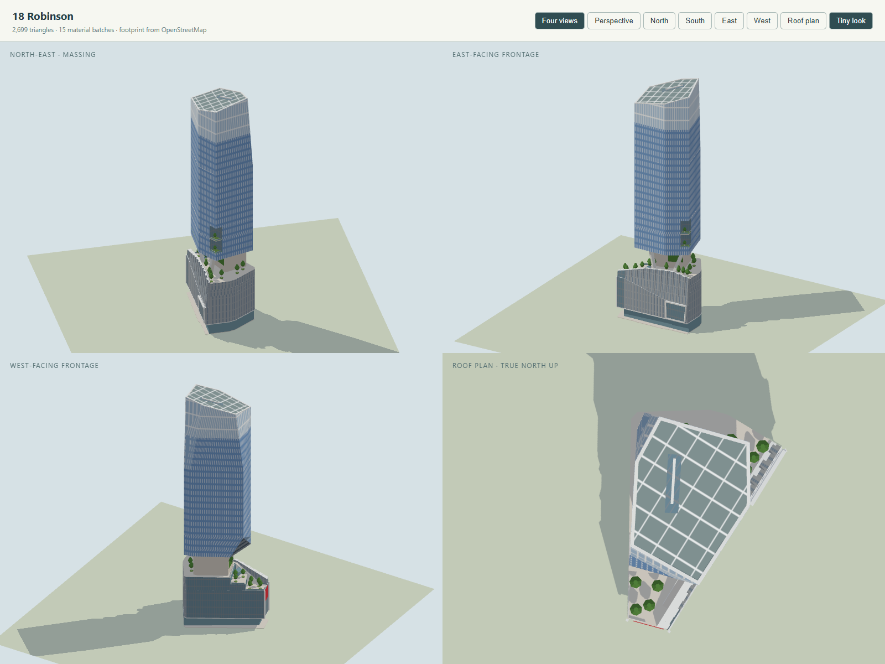

# 18 Robinson model

Checklist **SG-061**. Program: `js/landmark-models/18-robinson.js`; tests: `tests/landmark-18-robinson.test.cjs`. Built on 4 November 2026 with the landmark kit and the city's normal/Tiny material pairing, replacing a placeholder that extruded the mapped parts.

18 Robinson, 18 Robinson Road, is an office and retail tower by Kohn Pedersen Fox, with Architects 61 as architect of record, for Tuan Sing Holdings. It was called Robinson Tower while it was designed, and was completed in 2018–19. It stands on a V-shaped site between Market Street (west) and Robinson Road (east), whose point faces Lau Pa Sat to the south. A faceted retail podium fills the site, its roof garden climbing in terraces from the tip. Over the podium a faceted glass office tower is lifted on its core and two raking struts, leaving an open sky garden between them. The checklist asks for the faceted tower, the sky garden and the split podium.

## References and interpretation

The as-built period is the building as completed (2019) and as photographed in 2024. Nothing seen in later sources suggests the massing has changed.

- [CTBUH Skyscraper Center](https://www.skyscrapercenter.com/building/18-robinson/35956), read 4 November 2026:
  - 180 m to the architectural top and to the tip, and 150 m to the highest occupied floor;
  - 28 floors above ground and 6 below, completed 2019;
  - KPF as design architect, Architects 61 as architect of record, KTP Consultants as structural engineer, concrete–steel composite.
- KPF's drawings in the [ArchDaily project](https://www.archdaily.com/955916/18-robinson-building-kpf) (published 29 January 2021, photographs by Tim Griffith):
  - **The program-stacking section** is labelled "Height to Architectural Top and Tip: 180 m" and "Height to Highest Occupied Floor: 150.8 m". It shows a terraced podium garden stepping down to the tip over F+B retail, the office lobby and pocket-park retail. Over the top deck stand the core and struts, then a shallow sloping soffit, the offices with a mechanical floor, and the café and sky garden under the sloping glass roof. Its scale is about 10.75 px/m between the two labels. On it:
    - the soffit is about 57 m at the tower's edge and 54 m at the core;
    - the deck is about 40.9 m;
    - the 19 office floors from about 57 m to 150.8 m are 4.9 m apart;
    - the roof in the cut falls from about 169.8 m on the north to 165.5 m on the south, with the elevation beyond it rising to 180 m.
  - **The "strategically sculpted form" diagram**: start from a straight extrusion; lift an offset-core office tower over the podium; add "chamfers and folds"; then relate the podium's scale to Lau Pa Sat.
  - **The east elevation** (the Robinson Road face). Its scale is about 12 px/m along the face and 12.4 px/m up it, from the soffit at 56 m to the top at 180 m. On it:
    - the podium's face is not a box. An upright facet of perforated metal rises to a crease that falls from about 30.6 m near the tip to 21.4 m at about z −5.
    - Over the crease, a pleated facet leans back to a crest. The crest climbs from about 34 m at the tip to 43.5 m opposite the core, then drops to 41 m at the north end.
    - The tip's corner is glazed up to the crest.
    - The framed glass bay, about 15 m wide, is set in a tilted frame at the face's north end, from the podium's foot to the crease.
    - The top storeys of the tower are a paler, see-through glass screen, the fins carried on over it.
  - **The typical low-rise and high-rise floor plans**.
- [Dezeen, 5 September 2019](https://www.dezeen.com/2019/09/05/robinson-tower-skyscraper-kohn-pedersen-fox-kpf-garden-singapore/):
  - 175 m; twenty storeys of offices on concrete supports above a four-storey retail podium;
  - a green roof terrace between the two, shaded by the tower;
  - an atrium garden, a roof garden and planted balconies;
  - the core offset to the wider end;
  - angular façades that echo Lau Pa Sat's roof;
  - the V-shaped site formed by Robinson Road and Market Street.
- [ArchDaily, "KPF's Robinson Tower opens in Singapore"](https://www.archdaily.com/922235/kpfs-robinson-tower-opens-in-singapore) (1 August 2019), photographs by Tim Griffith:
  - **No. 1**: the podium from high up to the south-south-east. It shows the tip's lower terrace with trees and glass balustrades; the middle terrace with a small glazed pavilion with a pointed roof; and the top deck with trees round the grey stone core, whose vertical gardens sit under the soffit. One big raking strut runs up to the soffit's thin, sharp edge. The Robinson Road wing rises along Robinson Road in grey perforated metal, as a big leaning facet, with the stair up its inner side.
  - **No. 3**: the tower from Robinson Road by Lau Pa Sat, to the south-south-west. It shows the dark, reflecting facet of the fold at the foot of the south face, and the long crease of the head fold from the south-east corner at the roof down to the south-west corner at about 120–125 m. It also shows the north-west corner chamfered toward the top, and blue glass under white fins a bay apart, broken every storey.
- [KPF's project page](https://www.kpf.com/project/18-robinson): 20 office floors above the podium, a "hovering crystalline office tower", a landscaped podium and the rooftop Sky Garden with planted trees.
- [Architects 61's project page](https://a61.com.sg/projects/robinson-tower) (Robinson Tower).
- Wikimedia Commons:
  - [18 Robinson 1.jpg](https://commons.wikimedia.org/wiki/File:18_Robinson_1.jpg) and [18 Robinson 2.jpg](https://commons.wikimedia.org/wiki/File:18_Robinson_2.jpg) (Mx. Granger, 11 March 2024, CC0): the south elevation from the Market Street / Robinson Road junction. They show the whole tower and both folds, and Singlife's red banner on the podium's tip.
  - [(SGP-Singapore) Telegraph Street 2024-04-19.jpg](https://commons.wikimedia.org/wiki/File:(SGP-Singapore)_Telegraph_Street_2024-04-19.jpg) (S5A-0043, 19 April 2024, CC BY 4.0): the podium's Robinson Road face down Telegraph Street. It shows a tall glazed bay in a heavy silver frame, its north side leaning out toward the top, over the set-back shopfronts.
  - [18 Robinson, 2018 (01).jpg](https://commons.wikimedia.org/wiki/File:18_Robinson,_2018_(01).jpg) (Bahnfrend, 5 October 2018, CC BY-SA 4.0), [Skyscrapers in Singapore, 2018 (02)](https://commons.wikimedia.org/wiki/File:Skyscrapers_in_Singapore,_2018_(02).jpg) and [(03)](https://commons.wikimedia.org/wiki/File:Skyscrapers_in_Singapore,_2018_(03).jpg) (same author): the tower in its street context.
- [Esri World Imagery](https://www.arcgis.com/home/item.html?id=10df2279f9684e4a9f6a7f08febac2a9) tiles at zoom 19, with the OSM rings overlaid. The roof is displaced about 46 m east and 24 m south of its base by the oblique view. Shifted by that much, it matches the mapped tower ring. Its north-west corner is cut back more than the mapped ring's short chamfer. The glass roof is grey-green with white structure, and a dark slot along its west side holds the window-cleaning crane.

**Height.** CTBUH and KPF's own section both give 180 m to the architectural top. Dezeen's 175 m is taken to be a rounded or earlier figure. The model uses 180 m to its high north-west corner, and OSM's `roof:height=15` and `roof:direction=163` for the slope of the glass roof (165 m at the south-east corner). The section's 150.8 m is the floor of the café and sky garden under that roof.

The reference photographs stay outside the repository.

### OpenStreetMap ways replaced (hide list unchanged)

| Way | Tags | Use |
| --- | --- | --- |
| [424896147](https://www.openstreetmap.org/way/424896147) | `building=commercial`, "18 Robinson", 28 levels | the outline: paving and bounds |
| [1566724026](https://www.openstreetmap.org/way/1566724026) | `building:part=retail`, 0–7.5 m | the ground floor, set back under the podium |
| [1566724028](https://www.openstreetmap.org/way/1566724028) | `building:part=retail`, levels 1–5, 7.5–30 m, glass | the podium to the lower terrace |
| [1566724025](https://www.openstreetmap.org/way/1566724025) | `building:part`, 30–35 m, glass | the band to the middle terrace (its south edge the riser) |
| [1566724021](https://www.openstreetmap.org/way/1566724021) | `building:part`, 35–40 m, glass | the band to the top deck |
| [1566724022](https://www.openstreetmap.org/way/1566724022) | `building:part`, 40–56 m, `#85868f` | the core under the tower |
| [1566724023](https://www.openstreetmap.org/way/1566724023), [1566724024](https://www.openstreetmap.org/way/1566724024) | `building:part`, 40–56 m, about 3 × 3 m | the feet of the two raking struts |
| [1566724027](https://www.openstreetmap.org/way/1566724027) | `building:part=office`, 56–180 m, skillion roof toward 163°, 15 m | the tower's plan, its foot and its roof's slope |

The neighbours remain the city's or their own models:

- the Far East Financial Building (172000308), which shares the site's north edge;
- Grace Global Raffles (172000305);
- CapitaGreen, across Market Street;
- Lau Pa Sat, to the south.

Every way with a vertex inside the outline is in the list above. The only exception is the Far East Financial Building, whose three vertices lie on the shared edge.

## Frame and drawing

The anchor is x 46.0, z 253.0 in the city frame (bearing 31.8°). The city x points along the street grid toward bearing 121.8° and z toward 211.8°. Every ring is about the anchor, and the program takes all of its geometry from the mapped rings. In that frame:

- the podium's Robinson Road face is one straight wall at x ≈ 14.6, 57 m long;
- its Market Street face runs from (−23.6, −6.8) to the tip at (3.6, 38.9);
- the tip's face, 11.6 m wide, faces 195°;
- the north edge against the Far East Financial Building lies at z ≈ −21.5.

The tower's seven mapped corners are named in the program in this order:

- P0–P1, the west face (Market Street);
- P1–P2, the south face;
- P2–P3, the Robinson Road face;
- P3–P4, a short jog;
- P4–P5, the east face;
- P5–P6, the north face;
- P6–P0, a short chamfer at the north-west corner.

The terraces' edges are read off the bands' rings, as their points off the podium's outline: 30 m on 1566724025 and 35 m on 1566724021.

## Massing

| Mass | Heights (m) | Basis |
| --- | --- | --- |
| Ground floor: shopfront glass set back under the podium; paving over the outline | 0.32–7.5 | mapped |
| Podium west of x 11.3: silver band, then grey perforated metal with glass slots; silver mullions and teal-grey glass at the tip and along Market Street | 7.5–30 | mapped |
| Robinson Road wing (x 11.3 to the face), upright facet: the perforated metal folded in plan (0.3 m deep, a fold every 1.2 m), up to the crease, which falls from 30.6 m at the tip's glazed corner (z 30.2) to 21.4 m at z −5.2 and stays level over the bay; the corner from the tip to z 30.2 glazed | 8–30.6 | KPF's east elevation |
| Robinson Road wing, leaning facet: 24 pleats 2.4 m wide over the crease, leaning back 0.07 and 0.11 m per metre in turn (0.3–2.4 m at the crest), to a silver crest climbing from 34.5 m at the tip to 41.5 m by the stair's head (z 12.8) and 43.5 m opposite the core (z −8), then 41.5 m at the north end; glazed over the tip's corner | 21.4–43.5 | KPF's east elevation and Griffith No. 1 |
| Lower terrace at the tip: four trees in planters, glass balustrades | 30 | mapped |
| 30–35 m band; its south edge a glazed riser; the middle terrace with three trees and the glazed pavilion with a pointed roof | 30–35 (39.6 at the pavilion's ridge) | mapped; pavilion from Griffith No. 1 |
| 35–40 m band and the top deck: trees round the core, palms along the wing's crest, glass balustrade | 35–40.4 | mapped, 40.4 from the section |
| Stair up the wing's inner side, with a white handrail | 30–40.4 | Griffith No. 1 |
| Core: light grey stone, vertical gardens on its south and east faces | 40.4–55.5 | mapped (40–56) |
| Raking struts: 2.2 m square, from their mapped feet, the south one leaning 3.4 m toward Robinson Road and the north one 7 m toward the Far East Financial Building | 40.2–57 | feet mapped, lean estimated |
| Soffit: a pale funnel from the tower's edge down to the core | 52.5 (core) – 56 (edge) | KPF section (about 54–57) and OSM 56 |
| Foot fold: the south-west corner drawn in 9 m along the west face at the soffit, full by 72 m; a dark reflecting facet | 56–72 | estimated from Griffith No. 3 (top about 70 m) |
| Loggias at the north-east corner, 6 × 5 m, two planted levels with balustrades | 62–82 | estimated from photographs; KPF's "outdoor terraces integrated into key office floors" |
| Office shaft | 82–125 | mapped plan |
| North-west chamfer: from 125 m, the corner cut back 8.6 m along the west face and 4.1 m along the north face by 176 m; a paler facet | 125–176 | estimated from the aerial and Griffith No. 3 |
| Head fold: the south-west corner drawn in 5 m at the roof, its crease from the south-west corner at 125 m to the south-east corner at the roof | 125–168 | estimated from Griffith No. 3 and the 2024 photographs |
| Crown screen round the café and sky garden: the fins carried on unbroken over pale glass, a transom every two storeys; a skin 4 cm proud of the head's walls (one panel on each flat wall, one on each triangle of the folded south face and the chamfer) | 150.8–180 | KPF's section and east elevation, Griffith No. 3 |
| Glass roof over the café and sky garden, with a white rim: 180 m at the north-west corner falling toward 163° to 165 m; the crane's slot and arm on its west side | 165–180 | mapped (OSM roof), KPF, CTBUH; slot from the aerial |
| Telegraph Street bay at the north end of the wing's upright facet: 15 m wide (16.5 m at the top, its north side leaning 1.5 m north), its glass tilted out from 0.5 m at the foot to 1.3 m at the top in a 1 m silver frame | 8.6–21.4 | KPF's east elevation; 19 April 2024 photograph |

The façade is blue glass under white fins: fins 1.5 m apart, a quarter of the bay wide, and two thirds of each 4.93 m storey tall, so that they break at every floor as in the photographs. The kit's `punched` pattern does this, with the glass as its wall and the fins as its windows. The south-west fold's facet is a separate thin skin on its exact plane, 4 cm proud of the shaft's lofted walls. The head's south wall is one loft whose diagonal is the crease.

The podium's Robinson Road side is built as its own wing east of x 11.3. Its upright facet is a prism whose face is folded in plan and whose top follows the crease. The leaning pleats are lofts standing on it, each pleat's foot inside the upright facet and its outer face drawn back to the crest. Because neighbouring pleats lean by different amounts, the face shows alternating light and shade and a sawtooth crest, as the pleated metal does in the photographs.

Colours, from the photographs in daylight:

- the tower's glass with its fins samples `#576f89`–`#60768c` in Tim Griffith's photographs, under a blue sky;
- the podium's metal samples `#768996`;
- the Telegraph Street bay's glass samples `#4d7b80` in the 2024 photograph, and its frame `#bdc4c4`;
- the roof in the aerial samples `#6f786c`–`#7c847c`.

| Element | Colour |
| --- | --- |
| Tower glass | sky blue `#6b91bd`; the chamfer `#8aa9c9`; the foot fold `#3a4e62` |
| Crown screen | pale `#a3bbd0` between the fins |
| Fins, trim, soffit, struts, frames | `#dfe4e7` / `#d6dadb` |
| Podium metal | `#9aa2a8` with glass slots `#5f7080` |
| Podium glass (tip, Market Street, the bay) | `#4f6c78` in `#7d868d` mullions |
| Ground floor, risers, balustrades | `#5b7e86` |
| Core | stone `#cac6be` (the paving's colour) |
| Glass roof | `#6d7a72` in white frames |
| Planting | `#6d8f4a`, leaves `#4f7f3a` |
| Banner | Singlife red `#c0303a` |

### Sign

Singlife's red banner hangs on the glass of the podium's tip, toward 195°: a red panel 8.4 × 9.2 m from 20.2 to 29.4 m. Its white mark (4.6 m) is over the name "Singlife" (1.6 m), both hung with `kit.hang` on the tip's wall under the lower terrace. This follows Mx. Granger's photographs of 11 March 2024, the latest dated evidence found; it is not verified for November 2026. The mark is added to `js/landmark-logos.js`, simplified from those photographs, since no drawing is published on Commons. `tests/landmark-kit.test.cjs` lists its colour.

### Collision

- The ground floor is solid to 7.5 m, the podium to 30 m, and the two bands to 35 and 40 m.
- Each of the wing's pleats is solid from 30 m (or its foot) to the crest's low side over it. The middle flight of the stair is a 0.5 m step.
- The core is solid to the soffit, and each strut is solid in three short boxes along its rake.
- The soffit is a slab under the tower's foot, over a funnel half-way down.
- The tower is filled band by band, within the plans that the folds and the chamfer draw in, and the loggias are left open. The roof is filled in three strips up its slope, to each strip's low side.
- Open to walk and fly into: the walkways under the podium's overhang (at the tip and along Robinson Road), the air over the lower and middle terraces, the sky garden between the deck and the soffit, and the loggias. Outside the outline nothing collides.



## Inspect

```text
http://localhost:8014/tools/landmark-preview.html?model=18-robinson&view=all
http://localhost:8014/tools/landmark-preview.html?model=18-robinson&view=all&look=day
http://localhost:8014/tools/landmark-preview.html?model=18-robinson&view=s
http://localhost:8014/?look=tiny&at=18-robinson&camera=map
```

```powershell
node --test tests/landmark-18-robinson.test.cjs
```

The hide list is unchanged, so the geodata needs no rebuild.

The tests check:

- the nine replaced ways, and that the Far East Financial Building and Grace Global Raffles are not hidden;
- the 180 m height, standing on the ground within the mapped outline, and building in under 500 ms;
- the terraces at 30 and 35 m and the deck at 40.4 m at independently located points;
- the wing's crest climbing between the terraces along Robinson Road, with the stair beside it and trees on each terrace;
- the wing folded: its upright facet folded in plan (40 or more corners), at least 18 leaning pleats, each drawn back at least 0.25 m and alternating in lean;
- the crease falling from 29 m or more near the tip to 22 m or less over the bay, and the crest climbing from 38.5 m or less to 42.5 m or more;
- the Telegraph Street bay tilted in its four-piece frame;
- the walkways under the overhang open and paved above the lawn;
- the sky garden open under the tower at two points, the core carrying the tower from the deck, and two struts raking from the deck into the tower;
- the soffit sloping from 56 to about 53 m, with the shaft rising unbroken from it;
- the south-west corner folded in at the foot and full above it, and the north-west corner full lower down and cut back toward the top, both as lofted (inclined) facets;
- the loggias open at the north-east corner, with trees;
- the crown's screen, in seven or more pieces, from 150.8 m to the roof; the crown's high north side and lower south side;
- nothing floating;
- the two sign parts on the podium's tip wall, on their red panel, under the terrace;
- finite geometry, the triangle and batch budget, and no coplanar flicker;
- colliders solid in the podium, core and tower and on the terraces, and clear over the terraces, in the sky garden, the loggias, the walkways, and outside the site at 3, 40 and 100 m.

## Verification

- `node --test tests/landmark-18-robinson.test.cjs tests/landmark-kit.test.cjs tests/landmark-models.test.cjs tests/singapore-landmarks.test.mjs tests/city-geodata.test.mjs`: 110 of 110 pass.
- 2,699 triangles in 15 material batches (two of them the sign's), no coplanar flicker, built in about 17 ms in node.
- Rendered in the preview (headless Chrome, SwiftShader, WebGL backend) in the Tiny and day looks: the four views, and perspective views from the photographers' positions. Those views were compared with:
  - Griffith No. 3 from Robinson Road by Lau Pa Sat: the folds, the chamfer, the crown's lighter screen and the colour of the shaft;
  - KPF's east elevation, against a long-lens view square to the Robinson Road face: the wing's crease, crest and pleats, the glazed corner, the bay and the crown;
  - Griffith No. 1 from the south-south-east: the terraces, the pavilion, the stair and the wing, the core, the strut and the soffit;
  - the 2024 Commons photographs: the Singlife banner and the Telegraph Street bay;
  - the aerial: the roof plan, the crane's slot and the chamfered north-west corner.
- Checked in the live city on 4 November 2026 (`/?look=tiny&at=18-robinson&camera=map`, WebGPU in Chromium, after the loading overlay cleared and the map camera settled): it stands between CapitaGreen, the Far East Financial Building and Lau Pa Sat, the Singlife banner at the podium's tip; no generic mass of the replaced ways remains, no neighbour is missing, and the console shows no errors, missing models or flicker warnings. [City view](images/18-robinson-city.jpg). The preview with `backend=webgpu` renders it with no errors either.

## Limitations

- The fins are painted on the glass, not built. The kit has no see-through glass, so the crown's screen is an opaque pale band: the dark openings and the rooftop garden's trees behind it in the photographs are not shown. The screen's fins slant a little on the west face, where the chamfer and the head fold shorten the wall toward the top. The roof's diagonal structure, seen in the aerial, is simplified to a square grid.
- The folds, the chamfer and the loggias are estimates from photographs taken from below, so their exact heights and depths may be a few metres out. The roof is one plane toward OSM's 163°. KPF's section suggests it falls more steeply toward the east than the 15 m OSM gives.
- The Robinson Road wing's crease and crest are read off KPF's elevation, a design drawing, and checked against photographs. The real pleats are finer than the 2.4 m pleats modelled, and the perforation is a painted pattern on them. The Market Street face is upright glass. The atrium and escalators inside the podium are not modelled.
- The struts' lean and section are estimated from one photograph. The trees are generic.
- The Singlife banner is the 2024 sign; any later change of tenant is not reflected.
