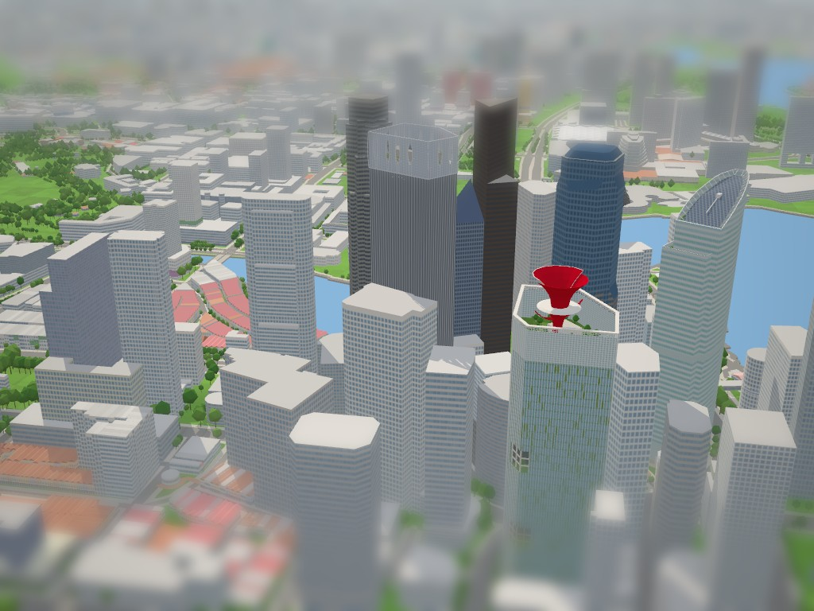

# CapitaGreen model

Checklist **SG-060**. Program: `js/landmark-models/capitagreen.js`; tests: `tests/landmark-capitagreen.test.cjs`. Built on 3 November 2026 with the landmark kit and the city's normal/Tiny material pairing, replacing a placeholder that extruded the mapped parts.

CapitaGreen, 138 Market Street, is a 40-storey office tower by Toyo Ito & Associates with Takenaka Corporation; RSP Architects Planners & Engineers was the architect of record. It was completed in 2014 on the site of the Market Street Car Park. The checklist asks for its planted façades and the red wind scoop on the roof.

## References and interpretation

- [CTBUH Skyscraper Center](https://skyscrapercenter.com/building/capitagreen/13978), read 3 November 2026. It gives 242 m to the architectural top and to the tip, a highest occupied floor of 197 m, 40 floors above ground and 3 below, and completion in 2014. Planting covers "55 percent of the perimeter of its façade", and the double skin cuts solar heat gain by up to 26 %.
- [Wikipedia](https://en.wikipedia.org/wiki/CapitaGreen) gives a 245 m height by a different measure. It describes a 45 m windcatcher "designed to look like flower petals" and a Sky Forest on the roof with 40 kinds of trees and shrubs.
- [Berkeley CBE Façade Map](https://facademap.cbe.berkeley.edu/building/capitagreen/) describes the double-skin façade (glass, double glazing, planters in the cavity) and the 45 m biomimetic windcatcher on the roof. It also names the team: RSP as executive architect, Arup for the façade, RWDI for wind, YKK AP as façade contractor.
- [RSP Architects' project page](https://rsp.design/rsp_work/capitagreen) has four photographs:
  - a high view from the south-east showing the whole tower, the cage and the scoop;
  - the scoop from inside the Sky Forest: a white petal in front, a red pointed petal behind and red horns spreading to both sides, rising from a white concrete box;
  - the club's pool inside the cage;
  - the raised block at the base: two glazed storeys between planted ledges, palms on its roof, square posts and white wavy columns under it.
- [Archigardener, "Tower as a Tree"](https://www.archigardener.com/?p=2151): photographs of the scoop from the Sky Forest, the plaza's wavy columns, the lobby and the planters between the skins. Ito likened the tower to a tree with the wind scoop as its crown.
- [Penang Travel Tips](https://penang-traveltips.com/singapore/capitagreen.htm), photographs of 1 August 2017: the plaza under the raised block from the north, a sky terrace above the block, and the name "CAPITAGREEN" over the lobby glass on the south-east wall.
- Wikimedia Commons:
  - [Singapore CapitaGreen-Building-01.jpg](https://commons.wikimedia.org/wiki/File:Singapore_CapitaGreen-Building-01.jpg) (CEphoto, Uwe Aranas, 20 February 2015, CC BY-SA 3.0): the crown from Marina Bay Sands, east.
  - [Singapore Skyline-01.jpg](https://commons.wikimedia.org/wiki/File:Singapore_Skyline-01.jpg) (same author and day): the whole top from Marina Bay Sands. The heights below were scaled from this photograph.
  - [CapitaGreen Tower 20250904.jpg](https://commons.wikimedia.org/wiki/File:CapitaGreen_Tower_20250904.jpg) (DvTor8303, CC0): an evening view from Lau Pa Sat, south-south-east, showing the sky terraces at the corners and the cage.
  - [Skyscrapers in Singapore, 2018 (02)](https://commons.wikimedia.org/wiki/File:Skyscrapers_in_Singapore,_2018_(02).jpg) and [(03)](https://commons.wikimedia.org/wiki/File:Skyscrapers_in_Singapore,_2018_(03).jpg) (Bahnfrend, CC BY-SA 4.0): from Cecil and Church Streets, showing the patchwork of finned and plain glass zones and a sky terrace.
- [Esri World Imagery](https://www.arcgis.com/home/item.html?id=10df2279f9684e4a9f6a7f08febac2a9) tiles at zoom 19, with the OSM outlines overlaid. The imagery is oblique, so the roof sits about 55 m east-south-east of the base. The roof's hexagon matches the mapped tower ring edge for edge: 55 m east–west, with sides of about 17, 47, 29 and 40 m. The aerial also shows the scoop as a red cross of four petals pointing roughly north, east, south and west, trees on the north half of the roof, and the blue pool along the south-west wall striped by the cage's shadows.

The reference photographs stay outside the repository.

### OpenStreetMap ways replaced (hide list unchanged)

| Way | Tags | Use |
| --- | --- | --- |
| [393100853](https://www.openstreetmap.org/way/393100853) | `building=commercial`, 40 levels, no height; the outline | not built (the parts cover it) |
| [1566865514](https://www.openstreetmap.org/way/1566865514) | `building:part`, 40 levels, 242 m, glass `#76838b` | the tower's plan |
| [1566865513](https://www.openstreetmap.org/way/1566865513) | `building:part`, levels 3–5, 20–30 m, glass, grass roof | the raised block |
| 1566865509–12 | four `building:part`s of about 1 m², 20 m | the posts under the block |

The neighbours remain the city's: 18 Robinson (424896147 and its parts), Grace Global Raffles and the streets.

## Frame and drawing

The tower's plan is a rectangle on the city grid (bearing 31.8°). Its east and west corners are cut off by true north–south walls: a 39 m wall on Market Street and a 16 m wall to the west. The program draws in metres with `u` along the grid toward Market Street (the city's x, bearing 121.8°) and `v` across it, away from the raised block (the city's z), from the mapped tower ring's extremes. The drawing is therefore independent of the anchor. In it the tower is 56.6 × 62.6 m: the north-east wall (shared with the raised block) is at v = 0, the north-west wall at u = 0, the south-east wall at u = 56.6 and the south-west wall at v = 62.6.

The wind catcher has its own frame. Its axis stands 3 m west of the plan's centroid, and its parts are turned to the compass, 10° west of north, as the aerial shows them, rather than along the grid.

### Scale of the crown

The heights of the crown come from [Singapore CapitaGreen-Building-01.jpg](https://commons.wikimedia.org/wiki/File:Singapore_CapitaGreen-Building-01.jpg) and [Singapore Skyline-01.jpg](https://commons.wikimedia.org/wiki/File:Singapore_Skyline-01.jpg), both taken from Marina Bay Sands to the east. From there the tower shows its whole north–south extent, about 84 m (computed from the mapped ring).

In the 3840-pixel Building-01:

- The tower is 2404 px wide.
- The typical storeys are 126 px apart, which at that scale is 4.4 m, a plausible office storey. Taking the visible face as 59 m would make them 3.1 m, too low for these offices.
- The cage's top rail lies 20.6 m under the tip, at about 221.5 m.
- The collar's top is 18.2 m under the tip, at about 223.8 m.
- The south petal's lip is 2.5 m under the white tip.
- The collar is about 27 m across.
- The terrace with trees on the north-east side is at about 198 m, matching CTBUH's 197 m highest occupied floor. The raised Sky Forest garden is at about 204 m.

The ratio of the petals' height over the rim to the cage's height over the garden is 1.2.

## Massing

| Mass | Heights (m) | Basis |
| --- | --- | --- |
| Lobby: tall dark glass in grey mullions on the whole plan | 0–20 | the posts' mapped 20 m; photographs |
| Raised block at the north corner: white planted ledges at 20, 25.2 and 29.6 m with glass 1.1 m behind them (flush with the tower on its south side), roof garden with palms | 20–30.4 | mapped 20–30 m; two storeys between three ledges in RSP's photograph |
| Four square posts under the block's outer edge, as mapped | 0–20 | mapped |
| Tower storeys L3–L40, 38 storeys of 4.75 m | 20–200.5 | estimated: CTBUH's highest occupied floor at 197 m |
| The outer skin's fins: pale, 1.5 m apart round the whole tower, 0.6 m deep | 20 (30.4 over the raised block) – 221 | photographs |
| Sky terraces cut into the corners (dark recesses with a planted floor, a tree, white columns and a slab edge each storey at the façade line) | 34.25–48.5 (north corner, 12 × 7 m), 77–91.25 (west corner, 18 × 9 m), 129.25–143.5 (west corner, 14 × 10 m), 134–148.25 (east corner, 7 × 42 m along the cut) | estimated from the Lau Pa Sat, Cecil Street and plaza photographs |
| Roof deck: the club's terraces round the Sky Forest, with the pool along the south-west wall | 200.5 | estimated; pool from the aerial |
| Sky Forest: a raised garden in white concrete walls over the middle of the deck; 20 trees on it and round it | 200.5–204.5 | Building-01 |
| Restaurant: a white box east of the neck, rising through the garden | 200.5–210 | RSP's and Archigardener's photographs |
| Cage: pale glass in a grid of frames (rails 1.25 m, mullions 1.5 m) just inside the fins | 200.5–218.8 | Building-01 |
| Cage: two rails across the open band over the glass | 218.8–221 | Building-01 |
| Cage: a flat white rim 2.2 m wide on the fins | 221–221.6 | Building-01 |
| Neck: red, from the deck, widening in a curve into the lower funnel | 200.5–222.3 | Building-01 (the red V seen through the cage) |
| Collar: a broad white disc, 25 m across | 222–223.8 | Building-01 |
| North petal: white outside, red inside | 223.6–242 | the 242 m tip as published and mapped |
| South petal: red outside and inside, its lip 2.2 m lower | 223.6–239.8 | Building-01 |
| Horns: two red blades springing from the lower funnel and sweeping out east and west under the collar to 17 m | 216.5–224 | Building-01; the Sky Forest photographs |

The two tall petals form one trumpet split north and south. Each is a 0.45 m shell wrapping 184° round the axis, lofted through six rings. Its radius grows with the square of the height over the collar, from about 4.5 m to 15–15.5 m, as the petals' edges curve in Building-01. Each is cut off at the top in a level lip. The two overlap a little to the east and west; the south one is outside there, since it starts wider and grows faster, so the shells never coincide.

The petals are red inside: the north one is warm white outside, the south one red. From the east the trumpet shows the south petal in red on the left, the north one in white on the right and the seam between them in front, as in Building-01. From the north it shows a white trumpet with red horns spreading to both sides, as in the Sky Forest photographs. From above it is a red bowl over the green garden.

The façade is the double skin, the same on every wall above the lobby. Pale sea-green glass carries the planting behind it as the kit's `scatter` pattern: a fine, sparse scatter of mid-green panels a bay (1.5 m) wide and a storey tall, with a planter's line each storey. About a quarter of the cells are planted low down, thinning to a sixth at the top. In front of the glass stand the built pale fins, 1.5 m apart. They stop where the sky terraces open, so the terraces show dark with their white frame, as in the Lau Pa Sat photograph.

Ground: the plaza under the raised block is paved 0.32 m high, above the city's lawn, and left open between the posts and the lobby. Among them stand 14 white wavy columns, each a 0.6 m beam in six bends from the paving to the soffit. Planted beds with palms run along the Market Street and Cecil Street edges.

Colours, from the photographs in daylight and at dusk. Averages sampled in the 2025 photograph from Lau Pa Sat, fins and glass together, run from `#6a7c84` to `#819ea7`; the cage's glass in Building-01 samples `#84a3aa`.

| Element | Colour |
| --- | --- |
| Glass | pale sea-green `#8fb2b5` |
| Planting behind it | mid-green `#7b9a5e` |
| Fins | `#e2e7e5` |
| Cage glass | `#a3c2c4`, in `#e4eae8` frames |
| Lobby glass | `#3c5159`, in `#9ba7a9` mullions |
| Wind catcher | signal red `#c8202e` and warm white `#ece8e0` |
| Pool | `#4f9fc4` |

Sign: "CAPITAGREEN" in green capitals 1.6 m high, hung on the south-east wall 4.5 m under the lobby's top, where the 2017 photograph shows the name over the lobby glass.

Collision:

- The tower is filled band by band. Its plan is cut along the corners' ends into rectangles and the corners' triangles, so that no collider spills onto the pavement outside the cut corners. The kit would otherwise take the whole six-sided plan as its box.
- The sky terraces are open to fly into.
- The raised block, the garden, the restaurant box, the neck and lower funnel, the collar, the cage's rim and each petal's plan (from collar to lip) are solid.
- The open air under the block and inside the cage at its walls is not.


## Inspect and rebuild

```text
http://localhost:8021/tools/landmark-preview.html?model=capitagreen&view=all
http://localhost:8021/tools/landmark-preview.html?model=capitagreen&view=ne&look=day
http://localhost:8021/tools/landmark-preview.html?model=capitagreen&view=e&focus=crown&look=day
http://localhost:8021/tools/landmark-preview.html?model=capitagreen&view=n&focus=crown
http://localhost:8021/tools/landmark-preview.html?model=capitagreen&view=n&focus=base
http://localhost:8021/?look=tiny&at=capitagreen&camera=map
```

```powershell
node --test tests/landmark-capitagreen.test.cjs
```

The hide list is unchanged, so the geodata needs no rebuild.

The tests check:

- the seven replaced ways, and that 18 Robinson is not hidden;
- the 242 m height, standing on the ground within the mapped outline, and building in under 500 ms;
- the Sky Forest's garden at about 204 m on the deck;
- the neck standing on the deck, and the collar just over the rim and about 25 m across;
- the funnel open over the collar;
- the north and south petals, each in at least five rings, flaring in a concave curve from the collar to wide lips at 242 and 239.8 m;
- the horns reaching past the collar;
- the restaurant and the trees;
- the cage: glass on all six walls from the deck almost to the top, a flat rim, over 120 fins rising to it, and nothing solid inside at the roof's edge;
- the plaza open under the block, the block from 20 to 30.4 m, the four posts to the soffit and the wavy columns;
- each sky terrace open between floor and ceiling, with storeys under it and the tower over it, free to fly into and solid above;
- that every raised part rests on or in something under it, or (a fin over a sky terrace) is fixed to the wall beside it, and that the crown's chain from the deck through the neck and collar to the petals is unbroken;
- the one sign on a south-east wall standing behind all of it, under the lobby's top;
- the triangle and batch budget, finite geometry and no coplanar flicker;
- colliders: the tower solid from the lobby to the deck, the neck and the block solid; the plaza, the cage's air and the pavement outside the cut corners (at 1.5, 60 and 150 m) clear.

## Verification

- `node --test tests/landmark-capitagreen.test.cjs`: 9 of 9 pass.
- 8,372 triangles in 12 material batches (one of them the sign), no coplanar flicker, built in about 30 ms in node.
- Rendered in the preview in the Tiny and day looks: four views, close-ups of the crown from the north, east and above, and of the base from the north. Compared with Building-01 and the Marina Bay Sands skyline photograph (crown, east), the Lau Pa Sat photograph (façade, south-south-east), the Sky Forest photographs (crown, north) and the aerial (roof).
- Checked together in the live city on 3 November 2026 (WebGPU, Tiny look, map camera from the south-south-west of
  CapitaSpring): the three model programs build without console errors or flicker warnings (CapitaSpring 43,932,
  Ocean Financial Centre 3,533 and CapitaGreen 8,372 triangles), no generic extrusion remains on any of the three sites,
  and The Arcade, 18 Robinson and the Market Street and Malacca Street neighbours still stand. The full suite
  (`node --test 'tests/**/*.test.*'`) passes 456 of 457 on this Windows checkout; the one failure is the
  pre-existing tile worker test in `tests/city-tiles`, which these models do not touch.



## Limitations

- The kit has no see-through glass, so the cage's glass is opaque. The Sky Forest, the neck and the lower funnel, which the photographs show through it, are seen only from above and through the open band under the rim.
- The trumpet is two shells of revolution with a quadratic flare. The real petals are doubly curved and their seams and folds differ. The horns are flat blades in five straight pieces. Their arrangement (±10°) is read from the aerial and the photographs from Marina Bay Sands and the Sky Forest.
- The roof plan shows a round red bowl. The aerial's four-pointed cross of petals (inner faces seen through the oblique lean) is not reproduced.
- The planting is a procedural scatter at a uniform density, not the surveyed layout. The real south-east wall's denser planted terraces from L3 to about L17 are not singled out.
- The sky terraces' positions and sizes are estimates from four photographs. There may be more than four.
- The top storeys are simplified: the gym and pool are on level 38 and the Sky Forest and restaurant on level 40, with terraces stepping inside the cage. Here they are a deck at 200.5 m and one raised garden at 204.5 m.
- 245 m (Wikipedia) and 242 m (CTBUH, OSM) disagree. The model uses 242 m to the north petal's lip.
- The face carrying the "CAPITAGREEN" sign is inferred from a 2017 street photograph. A lit sign seen edge-on near the top of the east wall in the 2025 photograph could not be read, so it is not modelled.
- The petals collide as their plans from collar to lip. The fins and the wavy columns do not collide. The plaza's monument sign, the café pavilion and its canopy are left out.
