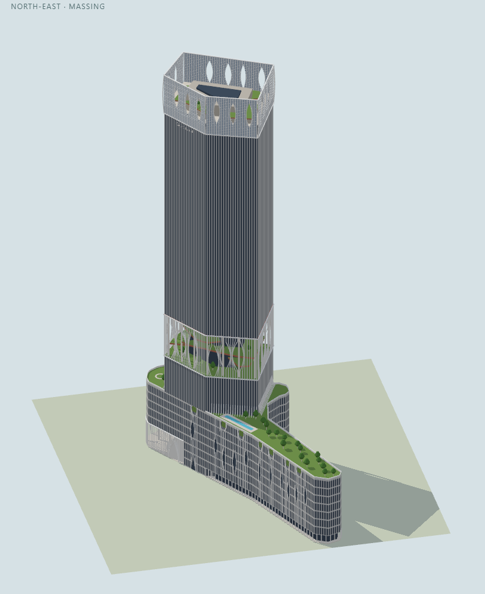
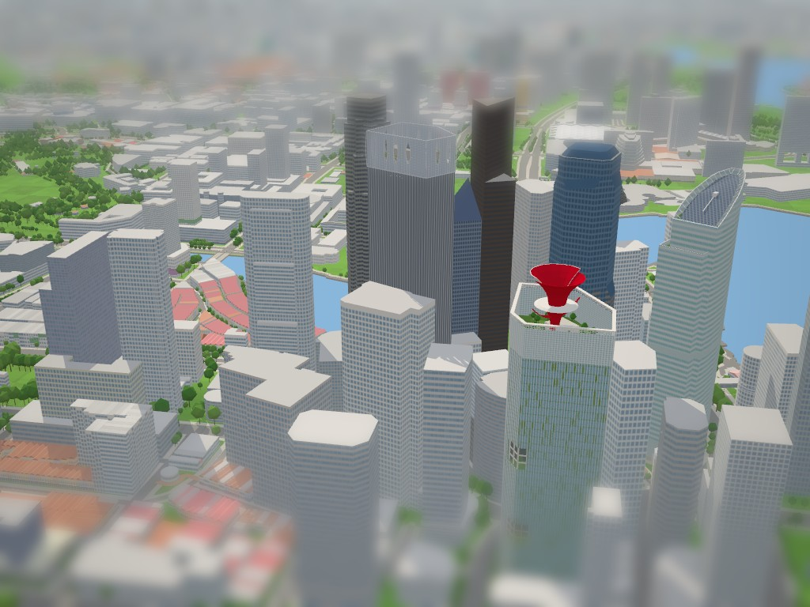

# CapitaSpring model

Checklist SG-004. Built on `claude/building-checklist-progress-ceabc0` on 3 November 2026 with the landmark kit and the city's normal/Tiny material pairing. Program: `js/landmark-models/capitaspring.js`; tests: `tests/landmark-capitaspring.test.cjs`.

CapitaSpring, 88 Market Street: Bjarke Ingels Group with Carlo Ratti Associati (concept), RSP Architects (project architect), completed November 2021, 280 m, 51 storeys, on the site of the Golden Shoe car park.

## References

- OpenStreetMap: the outline [694047464](https://www.openstreetmap.org/way/694047464) (`building=office`, `layer=1`), the podium [1157548671](https://www.openstreetmap.org/way/1157548671) (`building:part`, the same 31-point outline, 8 levels, metal, grass roof) and the tower [1157548672](https://www.openstreetmap.org/way/1157548672) (`building:part`, 7 points, 51 levels from level 8, 280 m, glass, grass roof). All three are replaced; the hide list is unchanged and right. Bank of Singapore Centre, Malacca Centre, Grand Building, Tan Ean Kiam Building and Royal Group Building stay to the city.
- CapitaLand, [CapitaSpring Design Fact Sheet](https://www.capitaland.com/content/dam/capitaland-newsroom/International/2022/february/capitaspring-marks-completion/CapitaSpring_Design_Fact_Sheet.pdf) (8 February 2022): 280 m; "pinstriped fins in its sleek aluminium façade"; the City Room, "a sheltered 18-metre-tall public alcove" connecting to the new public park on the pedestrianised end of Market Street; the levels (6 retail units L1, hawker centre L2–L3, car park L4–L8, Citadines serviced residences L9–L16, the Green Oasis L17–L20 with 312 m of spiral walkways, offices L21–L49, the Sky Garden and urban farm on L51 with the Sky Cube, MEP plant on a single floor under the rooftop restaurant); site area 65,700 sq ft (the whole outline is about 6,300 m²); a cycle path along Malacca and Phillip Streets.
- [Wikipedia](https://en.wikipedia.org/wiki/CapitaSpring): 280 m, 51 floors, completed 2021, food centre on the 2nd and 3rd floors, a garden about 100 m up.
- ArchDaily, [CapitaSpring / BIG + Carlo Ratti Associati](https://www.archdaily.com/989946/capitaspring-big-plus-carlo-ratti-associati) (October 2022): BIG's seven massing diagrams. The podium runs the whole strip ("two levels of hawker food market are located along the narrow tail end of the site"), the serviced residences sit "above the parking podium", the offices over a green connector band, and fins run "continuously from top to bottom of the building, creating pockets that reveal greenery".
- ArchDaily, [CapitaSpring tower opens in Singapore](https://www.archdaily.com/989641/designed-by-big-bjarke-ingels-group-and-cra-carlo-ratti-associati-capitaspring-tower-opens-in-singapore) (September 2022), photographs by Finbarr Fallon. These were the main references:
  - from above to the south (the narrow round end with Citadines' name, its roof garden, the tail's roof running north);
  - from Market Street by CapitaGreen, by day and at dusk (the south-east and Church Street faces, the round end, the Green Oasis, the crown with lens openings, CapitaLand's name edge-on on the Market Street face);
  - from Telok Ayer Street (the Church Street face, CapitaLand's name on the crown);
  - the City Room, the Green Oasis inside, the podium along the Market Street park, the pool deck, and the base's arches.
- Wikimedia Commons, [Category:CapitaSpring](https://commons.wikimedia.org/wiki/Category:CapitaSpring): [CapitaSpring1.jpg](https://commons.wikimedia.org/wiki/File:CapitaSpring1.jpg) (from Church Street by Telok Ayer Street: colours in sun, the lenses, the podium's planted top), [CapitaSpring2.jpg](https://commons.wikimedia.org/wiki/File:CapitaSpring2.jpg) (the Sky Garden: the crown's fins and slats, lens openings, terraced beds in red terrazzo, the grey pavilion) and [The CapitaSpring Building, Singapore (54410104486).jpg](https://commons.wikimedia.org/wiki/File:The_CapitaSpring_Building,_Singapore_(54410104486).jpg).
- NParks, [Market Street Park](https://www.nparks.gov.sg/visit/parks/park-detail/market-street-park): the former road between Republic Plaza II and CapitaSpring, now a park.
- Esri World Imagery at zoom 19 with the OSM outlines drawn over it (scratch overlay). The imagery is oblique: CapitaSpring's roof appears about 85 m east-south-east of its base, over the next block east, where it shows the five-sided crown of fins round a garden with winding paths and a central pavilion with a dark middle. It also shows the round end's planted roof and the tail's roof garden with a pool on its Market Street side. Royal Group Building's displaced roof hides part of the tail.

## Plan and frame

The drawing uses the mapped rings directly. The tower's five faces are named by their outward compass bearings. The north-west face (44 m) faces 328°. The Church Street face (59 m) faces 240°. The south-east face (30 m) faces 158°, the Market Street face (37 m) 90°, and the north-east face (33 m) 53°. The outline is cut along the tower's own faces into four pieces:

- the **tail**: the outline beyond the north-east face, about 20 m wide. It runs due north along Market Street for 41 m, then north-north-east to Chulia Street, about 95 m in all;
- the **sliver**: up to 8 m wide along the north-west face;
- the **round end**: about 30 × 13 m, a rounded lobe beyond the south-east face;
- the tower's own **pentagon**, from the mapped tower part.

The pentagon was checked against the aerial. Its displaced roof has the same five-sided shape and proportions within the imagery's distortion, so the tower rises straight on it. The pieces tile the outline exactly. Their shared walls face opposite ways, so nothing flickers.

## Massing

| Mass | Plan | Heights (m) | Basis |
| --- | --- | --- | --- |
| Podium (L1–L8): tail, sliver, tower plot | the outline | 0–47 | 8 levels mapped; 47 m measured (below) |
| — tail's ground storey | the tail inset 2.2 m: shopfronts under the overhang, fins to the ground every 3 m | 0–6 | estimated |
| — City Room | the round end and the tower's last 16 m along its south-east face, open from Church Street to the park | 0–18 open, podium 18–47 | 18 m published (CapitaLand); its extent estimated |
| Serviced residences (L9–L16) | the pentagon | 47–73.5 | measured |
| Green Oasis (L17–L20) | the pentagon, open behind the fins | 73.5–104 | measured (31 m; CapitaLand and press give about 35 m, "about 100 m up") |
| Offices (L21–L49) | the pentagon | 104–252 | measured |
| Plant storey (L50) | the pentagon inset 1 m, behind the crown's fins | 252–259 | estimated |
| Sky Garden (L51) | floor at 259; pavilion = the pentagon inset 11 m, to 267 (glazed roof box to 268.4); beds spiral 260–264.6 | 259–268 | estimated; pavilion's size from the aerial |
| Crown screen | the shaft's fin screen carried up: a lattice panel on every face, teardrop openings near the top, ring beam | 252–280 | 280 m published; the screen's height measured |

The heights were measured on the dusk photograph from Market Street by CapitaGreen, about 250 m south of the tower, which has its verticals corrected. In original pixels: crown top 190, Green Oasis top 2065 and bottom 2395, round end's planted top 2620–2665, street at the base 3188. That gives 10.68 px/m for 280 m. The round end stands about 15 m nearer the camera than the tower, so its roof is taken 5 % lower, at 47 m. The day photograph from Telok Ayer Street gives the same ratio of crown-to-oasis height (5.4 vs 5.7). The crown's lattice measures 20–28 m on the dusk photograph and 21–38 m on the Telok Ayer one; 28 m is used.

**Ground and podium.** The podium does run the whole 177 m strip; it is not a landscaped walk. BIG's diagrams draw one podium of uniform height the full length of the strip with a roof garden and a long lap pool. The aerial shows planting and a pool on the tail's roof, not a street. Sources describe the block as "bounded by Phillip, Market, Chulia and Church Streets". The Market Street park is outside the outline, south and east of the round end. The podium's height was only measured at the round end; the tail is assumed to share it, as BIG's diagrams draw it.

At the foot:

- the tail's ground storey is set back as a walkway with fins running down to the ground;
- the tower's Church Street and Market Street faces open in pointed arches over the lobbies;
- the City Room is an open hall 18 m high. Fins drop round it to the ground, with one tall pointed arch to each street and to the park. A white soffit is overhead, three white columns carry the tower's end, and the lobby wall behind is glazed.

On the podium roof there is a parapet, trees, the lap pool on a deck along the Market Street side, and the round end's lawn with its ring path. Where the tower rises out of the roof garden its fins flare onto the roof like roots, as in the pool photograph.

**Green Oasis.** It is open behind the fins. The fins are fixed to slab-edge bands at 73.5 m and 104 m and part in lens openings 6–9 m wide round all five faces. A glazed core (the pentagon inset 13 m) and a ring of white columns carry the offices. Three planted terraces with terracotta edges (81.2, 88.8 and 96.4 m) wind round the core like the spiral walk, with trees on them and on the floor. A terracotta soffit is overhead.

**Crown and Sky Garden.**

- The shaft's fin screen carries on 28 m above the offices to a ring beam at 280 m. As in the photographs, it reads from outside as a fairly solid, lighter lattice band, not an open cage. The fins keep the shaft's 1.5 m spacing over slats every 1.2 m, with the sky and garden seen between them.
- Each face is a thin panel painted with that lattice on both sides, so it shows from the street and from the garden. It is two 15 cm slabs back to back; each slab's ring starts where its painted fins fall on the shaft's own.
- The teardrop openings near the top of every face (about 4 m wide and 17 m tall) are real cut-outs, made a slat's row at a time.
- Real fins appear only where they bend round the openings, and at the five corners, where they bow out by up to 0.8 m.
- The pavilion and the planting are seen mainly from above and through the openings.
- Inside, on the plant storey, is the garden walk. Twenty wedge beds (four of them left out as paths) step up round a grey pavilion with a glazed roof box. Each bed has a terracotta lip on a grey base.

**Colours** (daylight photographs):

- Bright anodised silver fins (`0xe2e6e8`) over near-black navy glass (`0x141c29`): strong dark and light stripes, as in the photographs, on the tower and the podium alike.
- On the tower the fins are painted as pinstripes 1.5 m apart, a fifth of each bay (0.3 m), so the near-black glass dominates at a distance as in the photographs, with no floor lines; on the podium they carry its storeys every 5.8 m.
- The crown's lattice is the same silver over a mid blue-grey (`0x7f93a8`) for the sky and dark glass seen between: a lighter band than the shaft in both looks.
- Terracotta (`0xb4705a`) for the Green Oasis's terrace edges and soffits and the Sky Garden's bed walls (the photographs' red terrazzo and copper-coloured soffits).
- Light paving, green planting and a grey pavilion.

**Signs** (as on the building):

- "CapitaLand" in white at the top of the offices, under the crown, on the Church Street face (the Telok Ayer Street photograph) and on the Market Street face (seen edge-on from Market Street), 4.2 m tall.
- "citadines" in white over the City Room on the round end (the photographs from above and from Market Street), 2 m tall.
- Left out: CapitaLand's swoosh (no logo entry was added) and the small "CAPITASPRING" lettering near the base (its placement is unclear from the photographs).

## Inspect and rebuild

```text
http://localhost:8021/tools/landmark-preview.html?model=capitaspring&view=all
http://localhost:8021/tools/landmark-preview.html?model=capitaspring&view=s&look=day
http://localhost:8021/tools/landmark-preview.html?model=capitaspring&view=s&focus=oasis&look=day
http://localhost:8021/tools/landmark-preview.html?model=capitaspring&view=ne&focus=crown
http://localhost:8021/tools/landmark-preview.html?model=capitaspring&view=s&focus=city-room
http://localhost:8021/?look=tiny&at=capitaspring&yaw=11.8&pitch=38&dist=1150
```

```sh
node --test tests/landmark-capitaspring.test.cjs
```

The hide list is unchanged, so the geodata needs no rebuild.

## Verification

- `node --test tests/landmark-capitaspring.test.cjs`: 8 of 8 pass. They check:
  - the three replaced ways, 280 m, and every solid standing on the outline;
  - the bands: residences, the Green Oasis open behind its fins between floor and soffit, offices, and the Sky Garden's walk open to the sky over the plant storey;
  - terraces, core and columns in the Green Oasis;
  - every Green Oasis fin spanning its band and fixed at both ends, with lenses parting them;
  - the crown's bent fins running from its foot band to the ring beam, and the corner fins;
  - the crown's lattice on the wall line of every face, running the whole face under the openings, cut by them near the top, and painted on both faces;
  - the podium at 47 m along the strip to Chulia Street;
  - the City Room and the tail's walkway open, with the podium over them;
  - the three signs on their walls under the roofline;
  - budgets, flicker, finite geometry;
  - colliders: solid tower, podium and terraces; walkable City Room and walkway; flyable Green Oasis and Sky Garden.
- About 43,900 triangles in 14 material batches (two of them signs), no coplanar flicker, built in about 80–110 ms.
- Rendered in the preview from all sides in both looks, and compared with the photographs from Market Street (south) and Telok Ayer Street (south-west), the aerial (roof), and the Market Street park (east).
- Rendered in the city (Tiny look, map camera from the south-south-west, `yaw=11.8&pitch=38&dist=1150`). The tower reads among its neighbours by its pinstriped shaft and the lighter lattice band of its crown with teardrop openings. Nothing generic stands in or over it. From there, the Green Oasis and the podium are hidden behind Samsung Hub and the Church Street blocks.



- Checked together in the live city on 3 November 2026 (WebGPU, Tiny look, map camera from the south-south-west of
  CapitaSpring): the three model programs build without console errors or flicker warnings (CapitaSpring 43,932,
  Ocean Financial Centre 3,533 and CapitaGreen 8,372 triangles), no generic extrusion remains on any of the three sites,
  and The Arcade, 18 Robinson and the Market Street and Malacca Street neighbours still stand. The full suite
  (`node --test 'tests/**/*.test.*'`) passes 456 of 457 on this Windows checkout; the one failure is the
  pre-existing tile worker test in `tests/city-tiles`, which these models do not touch.



## Limitations

- The lens openings are generated from a seed with sizes and spacings read off the photographs. They are not traced lens by lens.
- The Green Oasis's 312 m spiral walk is approximated by three terrace levels. The rooms round its core are a glazed core.
- The City Room's extent and columns are estimated. The Citadines drum, the hawker centre's frontage and the loading bay are not modelled.
- The podium's 47 m is measured at the round end only; the tail is taken at the same height.
- The crown's openings are stepped a slat's row (1.2 m) at a time; the bent fins round them soften the steps.
- The crown's lattice and fins have no colliders, as before.
- In the Tiny look the kit blends every facade's glass 30 % toward the sky. With the fins painted a fifth of each bay, the near-black glass averages to a dark slate grey at map distance (`yaw=11.8&pitch=38&dist=1150`), though the stripes stay visible and the shaft reads darker than its neighbours. In the day look the stripes are strongly dark and light.
- Kit requests: a fins-only stripe pattern (or a floor-line weight for `strips`, which here needs a 400 m floor height and a second podium material), and an orientation option for `kit.beam` (a vertical beam's section follows the world axes, so the fins are square, not blades).
