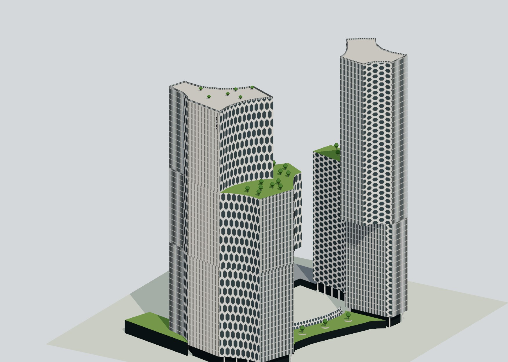
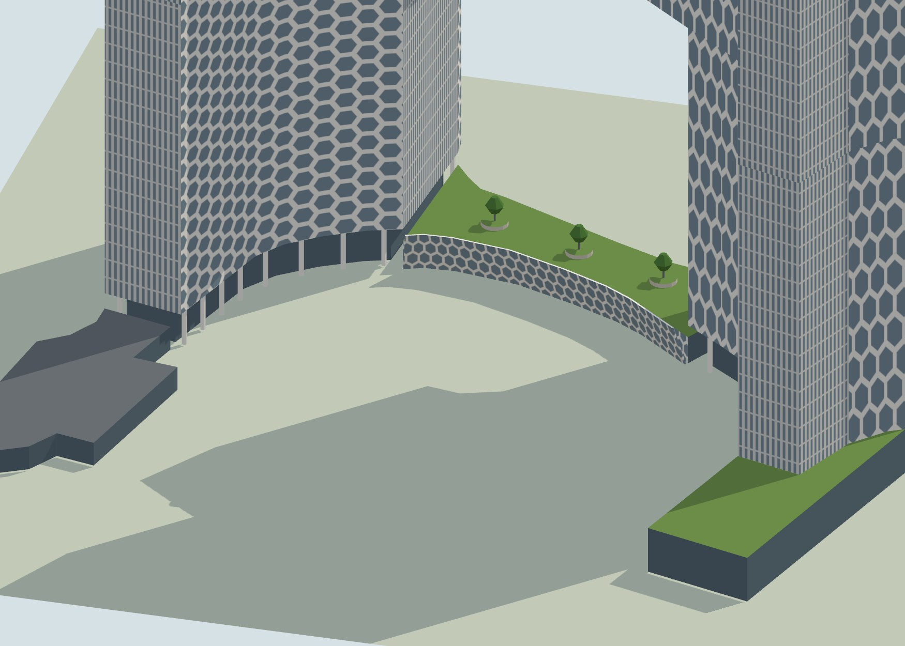

# DUO model

Modelled on `claude/building-models-map-37948b`, branched from `main` at `3bebb2c` on 2 November 2026, with the landmark kit and the city's normal/Tiny material pairing. Program: `js/landmark-models/duo.js`. Asked for as "Duo Residences"; the two towers are one design (and one development), so the model takes in both, and the low Duo Galleria between them.

## References and interpretation

- [OpenStreetMap](https://www.openstreetmap.org/way/427064874) supplies the stacks: DUO Residences `432375292` (to 76 m), `432375294` (76–102 m, cantilevering south) and `432375288` (102–193 m) with its outline `427064874`; DUO Tower `432375291` (to 73 m, 14 levels), `432375293` (73–127 m, cantilevering north) and `432375289` (127–185 m, 39 levels) with its outline `560240330` (`432375290` repeats its base); the Duo Galleria's outline `560240322` and its low parts `560275084` (between the towers), `560240327` (two levels beside the Tower) and `560275278` (a one-level metal-roofed arm to the north). These fourteen are replaced. The metal-roofed parts `1075253548/49/50` on the Galleria's arms carry no date or name and are left as mapped.
- Heights: [CTBUH](https://skyscrapercenter.info/complex/823) and [Wikipedia's list](https://en.wikipedia.org/wiki/List_of_tallest_buildings_in_Singapore) give 186 m for the Residences and 179 m for the Tower; [Wikipedia](https://en.wikipedia.org/wiki/DUO) gives 192.8 m and 185.35 m above sea level, which the mapped tops (193 and 185 m) match. The mapped setbacks are therefore taken as above sea level too and scaled to the documented tops (Residences 73.3 and 98.3 m, Tower 70.6 and 122.9 m). [Büro Ole Scheeren](https://www.buro-os.com/projects/duo) gives 186 m and 170 m, 50 and 39 floors.
- [ArchDaily](https://www.archdaily.com/890312) (photographs by Iwan Baan) and the architect's page: the circular carvings that make the faces toward the plaza concave, the "net-like hexagonal pattern" of sunshades (wide, flat-topped hexagons a storey tall on the Residences, tall pointed ones on the Tower), the vertical fins on the straight ends, the blocks shifting and cantilevering with planted terraces on the setbacks, the towers lifted on white columns over glazed lobbies, the leaning honeycomb screen along the plaza, the Galleria's planted roof with round planters.
- [The Commons photograph from Rochor Road](https://commons.wikimedia.org/wiki/File:Parkview_Square_and_Andaz_Hotel_buildings.jpg): the Tower's white south face, with the hotel's name running down it near its east end under the roofline.

The drawing's axes are the compass's 121.8° and 211.8° (the street grid as mapped, so the drawing stays put whatever bearing the city's frame takes), its origin from the Residences' upper block's extremes; only the plaza's middle is placed from it, everything else stands on the mapped rings. Estimated, not surveyed: the lobbies' height (8 m), the hexagons' size, the screen's lean, the trees.

## Visible features

- Each tower a stack of three blocks on its mapped rings; each wall the honeycomb where it faces the plaza or belongs to a curve, fins where it is a long straight end, and the Tower's south face white from the ground up.
- Glazed lobbies set back 3 m under the lowest blocks, white columns under the carved faces; the cantilevers' soffits drawn.
- Planted setbacks with trees (the Residences at 98 m, the Tower at 123 m), the Tower's rooftop garden, parapets round the tops.
- "andaz" down the Tower's south face (a vertical sign, a kit addition).
- The Galleria: the gallery between the towers under a green roof with round planters and trees, its honeycomb screen leaning out over the walk toward the plaza; the glazed pavilion beside the Tower; the metal-roofed arm.
- Colliders and footprints for every block to its height (the cantilevers solid, the air under them not); the plaza open.





## Inspect and rebuild

```text
http://127.0.0.1:8000/tools/landmark-preview.html?model=duo
http://127.0.0.1:8000/?look=tiny&at=duo&yaw=230&pitch=40&dist=650
```

```powershell
node --max-old-space-size=8192 tools/city/build.mjs singapore
node --test tests/landmark-kit.test.cjs tests/landmark-models.test.cjs
```

The kit gained what these two needed, each tested in `tests/landmark-kit.test.cjs`: the `honeycomb` facade pattern (pointed or flat-topped), per-wall materials on a prism or loft (`edgeMaterial`), `beam()` between two points for sloped members, and vertical signs.

## Verification

- The landmark, kit and city-generator tests pass (63 checks, merged with main's Raffles Hotel); the full `node --test` run on Windows passed but for the existing "tile worker" case in `tests/city-tiles.test.mjs`.
- 3,826 triangles in 13 material batches, no coplanar flicker. The sunshades are painted (the honeycomb pattern) rather than built hexagon by hexagon: a few thousand cells a face would cost well over the 65,000-triangle budget; depth comes from the stacked, cantilevered blocks, the set-back lobbies and columns, and the Galleria's screen.
- Rendered in the preview (WebGL, Tiny and day looks) against Iwan Baan's photographs and the Commons street view, and in the production city (WebGPU) from the north-east and south-west, without errors or flicker warnings. Regenerated geodata removes exactly the fourteen replaced ways.
