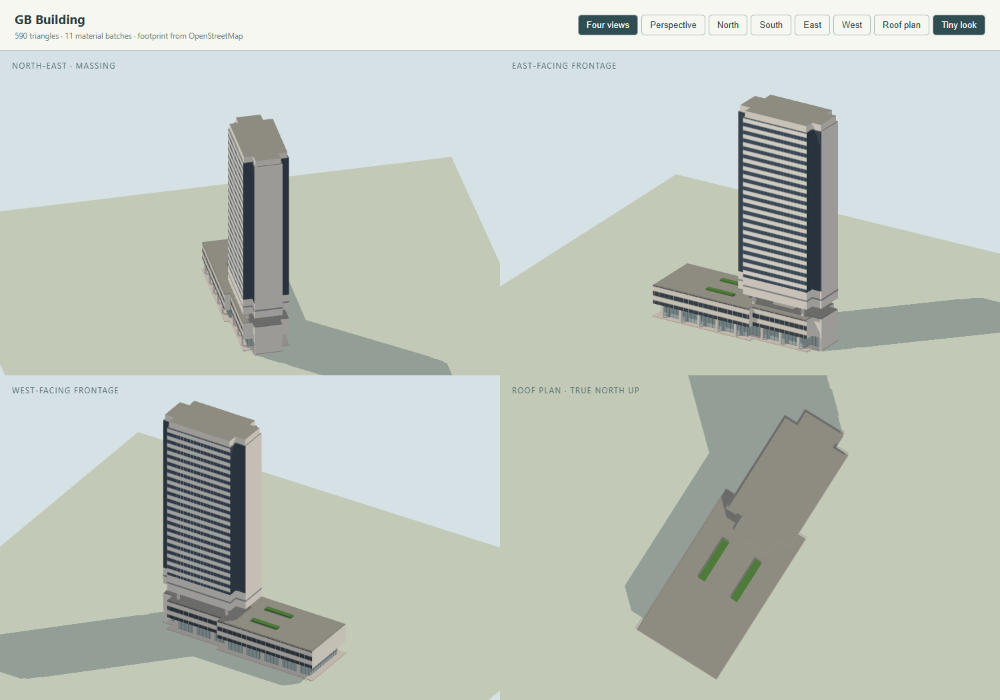

# GB Building model

Checklist **SG-075**. Program: `js/landmark-models/gb-building.js`; tests: `tests/landmark-gb-building.test.cjs`. Built on 4 November 2026 with the landmark kit and the city's normal/Tiny material pairing.

GB Building at 143 Cecil Street, on the junction with McCallum Street, was designed by Kenzo Tange (Kenzo Tange Urtec / Tange Associates) and completed in 1985–86. A three-storey podium follows the diagonal site across the block toward Robinson Road; at the Cecil Street (north-east) end the office tower floats over a recessed, open transfer level. Its broad faces are strict horizontal stripes — dark vision glass over bright spandrels — between almost blank off-white end walls. Two solid panel storeys, split by a thin grey stripe, form the shaft's base over the void.

## References and interpretation

- [Tange Associates project page](https://en.tangeweb.com/?p=2492) (values via the search index; the page itself has a certificate error): site 2,583.70 m², building area 1,496.50 m², total floor area 21,261.90 m², "29 stories with 3 basement", Singapore 1986. 29 less the 3 basement levels gives the 26 above-ground storeys of the marketing count.
- [CBRE via CommercialGuru, 2018](https://www.commercialguru.com.sg/property-management-news/2018/8/173677/part-of-tanjong-pagar-s-gb-building-up-for-sale): 143 Cecil Street at McCallum Street, Kenzo Tange, a 3-storey podium with a 23-storey office tower over it and a 26 ft (7.9 m) ground-floor lobby.
- [EdgeProp, 2021](https://www.edgeprop.sg/property-news/strata-office-floor-gb-building-going-10-mil): three-storey retail podium, 23-storey tower, 3-level basement carpark; typical tower floor plate about 5,425 sq ft (504 m²), consistent with the mapped tower. Its 2021 and 2023 sale photographs are the principal elevations used here: the McCallum Street face with the podium ribbons, the recessed ground glass, the open transfer level with its core boxes, the solid band with its grey stripe, the striped shaft and the blank Cecil Street end wall carrying the small "GB BUILDING / 143 CECIL STREET" name at street level.
- [Invar Realty Pte Ltd v Kenzo Tange Urtec Inc [1990] SGHC 61](https://www.elitigation.sg/gdviewer/gd/1990_SGHC_61/pdf): "a 28-storey commercial building … a podium and a tower block … a glass curtain wall from the 5th to the 28th storeys". The 28 counts levels the exterior does not all show (see Height).
- [SkyscraperPage 14629](https://skyscraperpage.com/cities/?buildingID=14629) and its duplicate [24275](https://skyscraperpage.com/cities/?buildingID=24275): roof 240 ft (73.2 m), 28 floors, finished 1985; the duplicate marks the height **"Unconfirmed"**. No CTBUH entry exists.
- [NLB photograph, "G B Building: exterior"](https://www.nlb.gov.sg/main/image-detail?cmsuuid=fbac0eae-c0bd-428c-80a6-e668cde270d0).

The reference photographs stay outside the repository.

### Height

**The model is 93 m, an estimate; the only published figure (240 ft / 73 m, repeated in OSM's `height=73`) is not used.** It is marked unconfirmed by its own source, and it cannot be reconciled with the building:

- 73 m over 26–28 storeys, including a 7.9 m lobby level and the open transfer level, implies under 2.8 m floor-to-floor — below any plausible 1980s office floor with structure and services.
- The EdgeProp photographs show about twenty dark glass bands over the two solid storeys. Twenty office floors at 3.3 m (66 m) over podium (13 m), void (4.5 m), solid band (7 m) and parapet (2.5 m) gives **93 m**.
- In the wide 2021 photograph the parapet stands at a little over half the height of the 174 m (mapped) Oxley Tower beside it, which is further from the camera; 73 m would be about two-fifths.

The exterior band count (3 podium + void + 2 solid + 20 glass + parapet) gives the 26 above-ground levels of the Tange/marketing count. The court's "glass from the 5th to the 28th storeys" (24 bands) presumably counts mezzanine or split levels the façade does not show.

### OpenStreetMap ways replaced

| Way | Tags | Use |
| --- | --- | --- |
| [504809533](https://www.openstreetmap.org/way/504809533) | "GB Building", `building=office`, 143 Cecil Street, `start_date=1985`, no height or levels | the site: the podium's footprint and roof, the ground-floor recess, the tests' outline |
| [326926543](https://www.openstreetmap.org/way/326926543) | `building:part`, 28 levels, 73 m | the tower plate: a 19.8 × 28.7 m slab with narrower (~11.7 m) tabs 4.2–4.5 m deep at both ends, drawn as mapped |
| [1566584725](https://www.openstreetmap.org/way/1566584725) | `building:part`, 3 levels | the podium part toward Robinson Road; the model draws the podium over the whole outline, as built |

No relation includes any of the three. The neighbours remain the city's: Oxley Tower (172270395 and its parts 1566584723, 1479526103) immediately south-east, Tung Ann Association Building (172024968), Robinson Square (172270399), TAHIR Building (172270428) and the SBF Center parts sharing the south-western boundary nodes.

## Frame and drawing

The site lies on the Cecil/McCallum grid (~32.5°), close to the city frame's 31.8°, so the mapped rings arrive almost axis-aligned (long axis along local `z`: tower at the negative-`z`, Cecil Street end; podium stretching to `z` +45 toward Robinson Road). The program draws from the mapped rings themselves, classifying each edge by length and run (broad faces along the slab; ends and returns across it), and places the void's core and columns on the tower ring's own oriented box (`kit.boxOf`).

| Feature | Value (m) | Basis |
| --- | --- | --- |
| Outline (504809533) | ~25 wide × ~72 long, diagonal | mapped |
| Tower plate (326926543) | 19.8 × 28.7, end tabs ~11.7 wide × 4.2–4.5 deep | mapped |
| Recessed ground glass | outline inset 2.4, columns ~8.2 apart on both long faces | photographs (the covered walkway and 7.9 m lobby; modelled 5.4 m to the podium soffit) |
| Podium | outline, 5.4–13; deck slab and planters to 13.95 | OSM 3 levels; height estimated |
| Transfer void | 13–17.5, core 9 × 7 at the tower's centre, four 0.9 m columns | photographs |
| Solid band | 17.5–24.5, grey stripe 20.7–21.4 standing 0.07 proud | photographs |
| Glass shaft | 24.5–90.5 (20 bands at 3.3) | band count from photographs; floor height estimated |
| Parapet crown | tower ring inset 0.55, 90.5–93 | photographs |

## Palette and signs

Sampled to the daylight photographs: off-white panels `#e8e6e0`, bright spandrels `#eef0ec`, dark blue-grey vision glass `#1d2c3f` (ribbon stripes, 3.3 m floors), near-black podium ribbons `#141a20`, pale lobby glass, grey stripe `#9aa0a4`. The tower's short step-return edges are dark glass slots (`#1a242e`), as the photographs show beside each end wall. One sign: "GB BUILDING" in small dark capitals low on the north-east end wall at the street corner, as photographed. No tenant or crown signage exists, so none is modelled.

## Collision

- On the ground: the lobby (outline-filled), the walkway columns, the north-east end wall.
- Explicit volumes: the podium and its deck slab; the void's core and columns; the tower from the solid band to the parapet (17.5–93 m) over the mapped tower ring.
- Left open: the covered walkways under the podium on both long faces; the transfer void around its core; the podium roof; the streets and the gap to Oxley Tower.



## Inspect and rebuild

```text
http://127.0.0.1:8012/tools/landmark-preview.html?model=gb-building&view=all
http://127.0.0.1:8012/tools/landmark-preview.html?model=gb-building&view=ne&look=day
http://127.0.0.1:8012/tools/landmark-preview.html?model=gb-building&view=ne&backend=webgpu
http://127.0.0.1:8012/?look=tiny&at=gb-building&camera=map
```

```powershell
node --max-old-space-size=8192 tools/city/build.mjs singapore
node --test tests/landmark-gb-building.test.cjs
```

## Verification

- `node --test tests/landmark-gb-building.test.cjs`: 5 of 5 pass — the three replaced ways with Oxley Tower and the Robinson Road neighbours kept; 93 m within the mapped outline; the podium roof at 13 m with the podium-only stretch open over it; the transfer void open beside its core with the solid band over it; the McCallum walkway open under the solid podium; the one street-level sign; budgets, finite geometry, no flicker.
- 590 triangles in 11 material batches, 33 parts.
- Targeted suite (`landmark-kit`, `landmark-models` with the height pinned at 93, `singapore-landmarks`, `city-geodata`, `building-info` and the three new files): 157 of 157 pass. Full `node --test` on Windows: 648 of 656; the 8 failures (7 Overpass shell fixtures, 1 tile worker) fail identically on the untouched base.
- Rendered headless (Chrome): the four-view Tiny preview, the north-east elevation in the day look, and the WebGPU backend all render without errors, and were compared against the EdgeProp photographs (band count, solid band and stripe, open void, podium ribbons). Regeneration took the city from 46 landmarks / 538 parts to 49 / 543 (with SG-083 and SG-084).
- Checked in the live city on 4 November 2026 (`/?look=tiny&at=gb-building&camera=map`, WebGPU, after the overlay cleared): the tower stands on the Cecil/McCallum corner with Oxley Tower beside it; no generic mass of the replaced ways remains and no neighbour is missing. [City view](images/gb-building-city.png). The console showed no landmark errors or flicker warnings (one unrelated resource fetch was refused by the local test server).

## Limitations

- **The 93 m height is an estimate** from the photographed band count at assumed 3.3 m office floors. The published 73 m is unconfirmed and internally inconsistent, but no surveyed height was found; the podium, void and band heights are likewise photographic estimates.
- The glass bands are painted (the kit's ribbon pattern), not modelled mullion by mullion; the podium's stepped bays and its projecting canopy slab on McCallum Street are simplified to the mapped outline.
- The transfer level's core is one central box; the photographs show two smaller core boxes and terrace steps.
- The roof is a plain parapet cap: no aerial or roof plan was found, and no plant is visible from the street.
- The north-west (rear) face repeats the McCallum Street treatment; no photograph of it was found.
