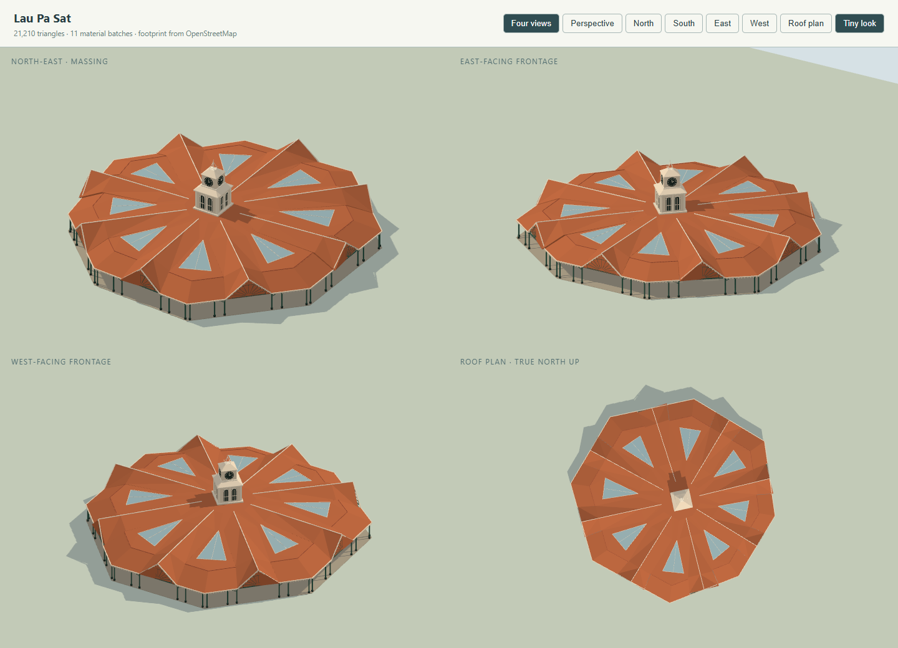
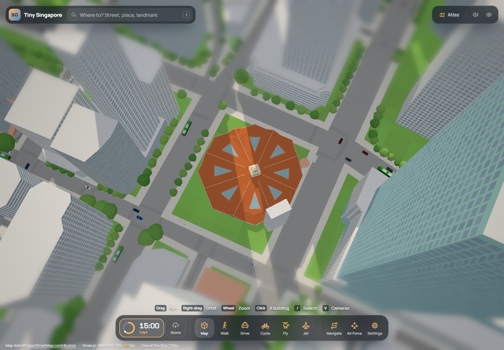

# SG-039 — Lau Pa Sat

Scope claimed by Codex / worktree 18e5 on 2026-11-03, following the user's assignment to choose two unowned buildings. This model depicts the conserved market as photographed in the operator's 2024–2025 media library. Elevations and small details are visual estimates, not a measured survey.

## Sources inspected before geometry

- [NHB / Roots — Former Telok Ayer Market](https://www.roots.gov.sg/places/places-landing/Places/national-monuments/former-telok-ayer-market-now-known-as-lau-pa-sat), accessed 2026-11-03. Authoritative identity and description of the octagonal market, eight radial entrances, ventilation, central lantern, clock and prefabricated cast iron. The search-index text was accessible; the live page presented a JavaScript verification screen.
- [Operator — heritage](https://www.laupasat.sg/heritage/), accessed 2026-11-03: conserved 1894 iron building at this location and its later hawker use.
- [Operator — media library](https://www.laupasat.sg/media-library/), accessed 2026-11-03. The following actual photographs were downloaded only to temporary storage and visually inspected; none is redistributed in the repository.
- [Roof/site photograph, Fahrul Azmi / Unsplash, operator upload April 2024](https://www.laupasat.sg/wp-content/uploads/2024/04/LPSBirdsEyeView_FahrulAzmi_Unsplash_highres.jpg): the octagonal roof, eight radial ridged naves and eight triangular glazed airwells between them. The broad outer hip is interrupted by entrance gables; this is more specific than a plain concentric hip.
- [Cross Street entrance elevation, © Sim Heng Ee, operator upload March 2025](https://www.laupasat.sg/wp-content/uploads/2025/03/IMG_18-High-Res-Cross-Street-Entrance-%C2%A9Sim-Heng-Ee-1.jpg): low terracotta roof, cream valance, dark green cast-iron fanlight, cream lantern, four clock faces and openwork spire.
- [Robinson Road wing interior, © Sim Heng Ee, operator upload April 2025](https://www.laupasat.sg/wp-content/uploads/2025/04/IMG_08-High-Res-Robinson-Road-Wing-%C2%A9Sim-Heng-Ee-1.jpg), and [atrium, © Sim Heng Ee, operator upload June 2025](https://www.laupasat.sg/wp-content/uploads/2025/06/IMG_10-Low-Res-Atrium-%C2%A9Sim-Heng-Ee.jpg): green slender iron columns, composite capitals, open curved braces, cream roof underside and traversable central aisles. The former filename is an interior view despite its wing label.

## Mapped boundary and exclusions

Raw extract: `tools/data/singapore/osm_buildings.json`, OSM base timestamp 2026-10-25T06:21:41Z. Replace way **45098520** (`building=retail`, `amenity=food_court`, name Lau Pa Sat, `height=0`) and roof `building:part=yes` ways **463863828–463863835** (each `height=9`, single level, tiled skillion roof in eight compass directions). The zero parent height is invalid and is not used. No relation references these nine ways; none supplies inner rings. The wedge ways converge on node8167597426 at **1.280616, 103.8505047**, providing a stable physical roof centre.

Parent bounds: latitude 1.2802841–1.2809406, longitude 103.8501500–103.8508034; approximately **72.7 m east–west × 72.6 m north–south**. The mapped outer perimeter has eight main corners plus four nearly collinear subdivisions. Preserve that perimeter and its irregular proportions.

Retain separate detached objects: Indian Grill & Bar **679027931** south of the octagon; eastern small Kopitiam structures **679027932**, **679027933**; neighbouring Hong Leong Building **47345013**, City House **47345012**, One Raffles Quay **47345006**, SGX Centre **45098518/47345025**, and the western office rows. The model adds no street-wide slab, umbrellas or invented stalls outside the replacement perimeter.

## Coordinate frame, proportions and collision

`site.parts[].ring` is already in the city frame, relative to the generated anchor. The anchor is the generator's vertex average, not the roof centre. Recover the centre from the shared vertex of the eight roof wedges; the fallback uses the westmost parent vertex plus its mapped **39.473 m true east and 5.838 m true south** displacement. Use compass vectors rather than assuming world x is true east.

Mapped plan dimensions are retained. Visual estimates: eaves about **4.6 m**, outer hip joins at **7.2 m**, radial gable ridges **9.2–9.5 m**, upper inner roof about **9.5 m**, lantern **10–14.8 m**, clock body **15–18.5 m**, spire/finial about **22 m**. The radial nave middle sections are approximately **9 m wide**, and each triangular airwell has a **7.6 m base**, estimated from the roof photograph. The building has an orange-brown tile roof, cream tower/trim and dark green iron; these are photograph-guided colours.

Ground geometry consists of a thin paved floor, individual columns and discontinuous stalls. Eight radial aisles remain clear below the roof. Roof sections and glazed airwells have explicit altitude-aware collision; the clock tower is solid only above the central roof. Collision uses conservative flat bands inside sloping roofs and kit scanline boundary approximations (up to about a metre), rather than a full-height octagonal collider. Small iron curls, tiles, stall menus and furniture are simplified for map-scale readability.

## Verification

`node --test tests/lau-pa-sat.test.cjs` passed **6/6** on 2026-11-03. The first run failed all four initial tests with the intended missing-model assertion. Render-driven regressions subsequently failed on narrow glazing and nonplanar roof polygons before their fixes. The final tests cover the actual nine replacement anchors, independently geolocated roof centre, eight open radial aisles, elevated solid roof, clear neighbouring streets, broad triangular glazing, roof-plane coplanarity, finite placement and geometry, budget and zero coplanar flicker.

Final model statistics: **21,210 triangles, 11 material batches, 1,444 procedural parts, 1,165 collision volumes, zero kit flicker pairs**. The upper roof uses eight whole-side planar hip facets; the outer hip uses sixteen planar half-facets joined on the mapped corner lines. Raised nave roofs have explicitly chosen triangles at their change in pitch, preventing arbitrary triangulation folds.

The operator's aerial, Cross Street elevation and two interior photographs were inspected before modelling. The final model was compared with them in four-view Tiny/day previews through actual WebGL and WebGPU backends on 2026-11-03, including the roof plan, principal elevation and rear/side. Render feedback led to broader glazing, explicit outer hips and planar roof sections. All four preview combinations compile without exceptions or console warnings and report zero flicker. The loaded WebGPU city retains surrounding buildings, including the separate restaurant; no landmark or shader errors occur. Chrome reports only its standard Windows warning that `powerPreference` is ignored.

Independent code review checked the source photographs, all six model tests, exact replacements, clear ground-level aisles and roof collision. It additionally verified all 509,040 emitted vertex/normal/UV values are finite and sampled roof collision against the emitted surface. The small central lantern hip remains a conservative collision approximation, up to about 0.5 m above its tapered outer skin. No required review fixes remain. The checklist records completion through [PR #7](https://github.com/datainvestor/tiny-singapore/pull/7), effective when the PR merges.

Local preview: `/tools/landmark-preview.html?model=lau-pa-sat&view=all`; city: `/?look=tiny&at=lau-pa-sat&camera=map&yaw=25&pitch=76&dist=360`. The steeper city view keeps the market visible among the surrounding office towers.

Material simplifications: the kit's glass is opaque glossy/sky-tinted glazing; roof interiors use a conservative cream underside at **4.55 m**, rather than the full vaulted construction. Roof collision comprises low solid bands and higher narrow nave volumes (to **8.05 m**) so descending players stop while the market remains open below. The roof is modelled as filled elevated sections, including gable backs; fanlights and ironwork remain selective geometric detail. These approximations do not turn the ground floor into a solid octagonal building.

Repository integration verification (2026-11-03): **75/75 targeted checks pass** across the landmark kit, all models, both new site tests, Singapore registration and city generator. The **full suite passes 424/424** in a clean LF Linux copy under Ubuntu 24.04 / Node 22.23.4. The initial exported copy retained CRLF in existing shell fixtures; normalising the verification copy to LF resolved those environment-only failures without repository test changes. The Windows pre-change baseline had eight known shell/path fixture failures (402/410).

The generator changes only `GEO.buildings` and `GEO.landmarks`; all twelve earlier procedural anchors and the tree data remain identical. Independently decoding before/after building streams shows exactly twenty generic records removed (eight market wedges and twelve mosque masses), no added/changed generic records, and all other 16,050 retained. Building information is regenerated in the same order and preserves the restaurant, annexe and both new landmark addresses. Independent review has no remaining required fixes. The user authorised merging after final readiness checks. Completion is recorded through [PR #7](https://github.com/datainvestor/tiny-singapore/pull/7), effective when the PR merges.
