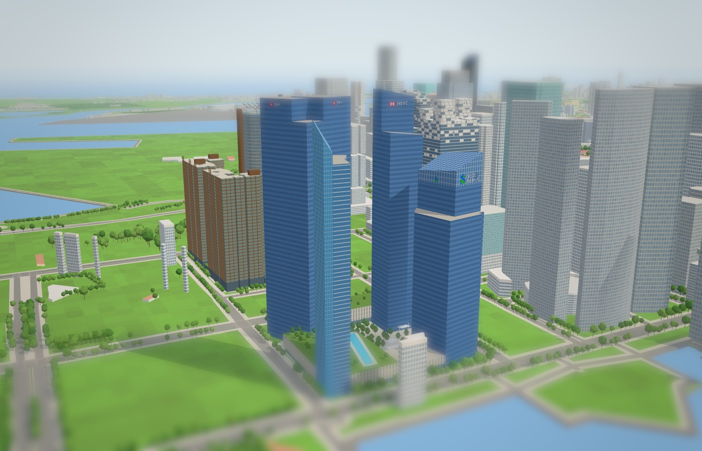
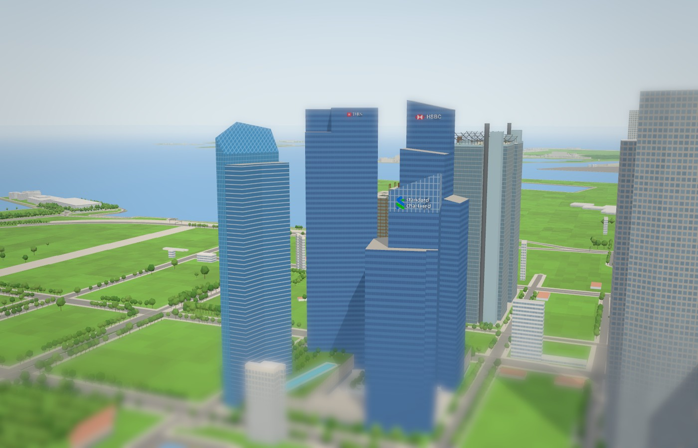

# Marina Bay Financial Centre model

Rebuilt on `claude/marina-bay-financial-centre-model-b61e72`, branched from `main` at `7363f8b` on 3 November 2026, with the landmark kit and the city's normal/Tiny material pairing. Program: `js/landmark-models/marina-bay-financial-centre.js`.

## What was wrong

The first model built a fifth, thin 222 m slab down the middle of the block, between Tower 1 and Marina Bay Residences, so from the bay the complex looked split in two. The slab came from OSM way [116905047](https://www.openstreetmap.org/way/116905047), an unnamed `building=yes` tagged `height=245`. On the aerial imagery that strip is the residents' lap pool on the podium deck. The model had taken it for Marina Bay Suites, which is not in this block: Wikipedia's coordinates and Nominatim put the Suites (3 Central Boulevard) across Straits View, where the city already draws it from way [393092728](https://www.openstreetmap.org/way/393092728) at 227 m. The towers themselves were single extrusions of the mapped outlines over a 19 m podium covering the whole block.

## References and interpretation

- OpenStreetMap supplies the footprints: Tower 1 [116905040](https://www.openstreetmap.org/way/116905040), Tower 2 [116905042](https://www.openstreetmap.org/way/116905042), Tower 3's outline [116905041](https://www.openstreetmap.org/way/116905041) and its four parts `509003526–29` (218, 238, 218, 239 m), Marina Bay Residences [116905045](https://www.openstreetmap.org/way/116905045), the podium `509003525` (19 m, four levels: the block less the towers), the pool strip `116905047` and Marina Bay Link Mall `728243729` (`layer=-1`, underground, not built). All eleven stay replaced; the hide list is unchanged. Every tower outline is tagged 245 m, so the program does not use those tags.
- Heights: [Wikipedia's list of the tallest buildings in Singapore](https://en.wikipedia.org/wiki/List_of_tallest_buildings_in_Singapore) gives Tower 2 245 m, Tower 3 239 m, the Residences 227 m and Tower 1 192 m (33 storeys); [the MBFC article](https://en.wikipedia.org/wiki/Marina_Bay_Financial_Centre) has the storeys and phases. Tower 3's terraces are its mapped parts.
- [KPF's project page](https://www.kpf.com/project/marina-bay-financial-centre): the towers turned for bay views, "a new city park" at the centre linking offices, homes and shops, retail opening onto plazas.
- Commons photographs from four sides, used to place the slabs and their tops: [from Marina Bay Sands 1](https://commons.wikimedia.org/wiki/File:Singapore_Marina_Bay_Financial_Centre_viewed_from_Marina_Bay_Sands_1.jpg) and [2](https://commons.wikimedia.org/wiki/File:Singapore_Marina_Bay_Financial_Centre_viewed_from_Marina_Bay_Sands_2.jpg) (east-north-east, elevated), [from Swissôtel The Stamford](https://commons.wikimedia.org/wiki/File:Singapore_Marina_Bay_Financial_Centre_viewed_from_The_Stamford.jpg) (north-north-west, elevated), [2023-03-21](https://commons.wikimedia.org/wiki/File:Marina_Bay_Financial_Centre_2023-03-21.jpg) and [2025-09-03](https://commons.wikimedia.org/wiki/File:Marina_Bay_Financial_Centre_20250903.jpg) (across the bay from the north), [2012-11-13](https://commons.wikimedia.org/wiki/File:Marina_Bay_Financial_Centre,_Singapore_-_20121113-01.jpg) (the Promontory, north-east) and [the open space in 2010](https://commons.wikimedia.org/wiki/File:Marina_Bay_Financial_Centre_open_space_2010.jpg) (the paved plaza with trees).
- [Esri World Imagery](https://www.arcgis.com/home/item.html?id=10df2279f9684e4a9f6a7f08febac2a9) over the block, with the OSM outlines overlaid, to identify the pool strip and the roofs. The imagery is oblique, so roofs lean about 60 m east-south-east of their bases; it confirms the pool and the four crowns, not the slabs' exact plans.
- The tenants' marks: HSBC's hexagon from [HSBC logo (2018).svg](https://commons.wikimedia.org/wiki/File:HSBC_logo_(2018).svg) and Standard Chartered's from [Standard Chartered Logo (2021, Logo only).svg](https://commons.wikimedia.org/wiki/File:Standard_Chartered_Logo_(2021,_Logo_only).svg), both public domain on Commons (trademarks, below the threshold of originality). Commons has no drawing of DBS's mark, so it is simplified from the photographs. All three are in `js/landmark-logos.js`.

The block follows the city grid (bearing 31.8°), so the drawing's axes are Marina Boulevard (121.8°) and across it toward the bay (31.8°), with its origin at the podium outline's extremes, independent of the anchor. The towers are cut from their mapped outlines along their own walls, so the slabs exactly tile each outline.

## Massing

| Tower | Mapped outline | Slabs (estimated from the photographs unless noted) |
| --- | --- | --- |
| Tower 1, corner of Marina Boulevard and Straits View | 51 × 55 m, turned 12° off the grid, notched at its north-west and south-east corners | The tall slab (south-west 70 % by 84 %) to 164 m, then a framed glass crown to 192 m (Wikipedia), falling 18 m toward 125°. A 138 m slab slides past it and wraps its north (bay) and east faces. |
| Tower 2, on Straits View | 51 × 34 m, on the grid | The tall slab (south half of the east 73 %) to 245 m (Wikipedia), falling 8 m toward the west-north-west. A 205 m slab sits on its north side, and a 165 m slab across its west end. |
| Tower 3, Central Boulevard and Marina Way | four mapped parts | 239, 238, 218 and 218 m, as mapped. |
| Marina Bay Residences, Marina Boulevard and Marina Way | a 56 × 25 m lozenge | The south-east half to 199 m under a glass crown to 227 m (Wikipedia), falling 24 m north-west. The north-west half is a balconied slab to 195 m. |

Podium and ground (estimates): the whole block between the towers is paved 0.32 m high, above the city's block lawn. The pool deck covers the podium east of the plaza and north of Tower 3, along Marina Way and around the Residences: 18 m, stone over glass shopfronts set back 1.4 m, a green roof with trees, and the 65 m lap pool on the mapped strip in a paved surround. A 13 m Marina Boulevard wing stands between Tower 1 and the deck, and a 19 m Central Boulevard wing with a roof garden south of Tower 2. The plaza in the middle and the gap on Straits View between Towers 1 and 2 are open: paved with trees, with a glass Link Mall pavilion under a canted roof (7.2–9.6 m) and four white sails on leaning masts (6.5–10.5 m).

Colours (from the photographs in daylight): Towers 1–3 are cobalt glass banded by a lighter blue spandrel each storey (`ribbon`), not a grid; Tower 1's crown is a lighter glass screen in a pale grid. The Residences are a lighter, greener glass between thin mullions, and their lower slab is glass with a white balcony edge each storey. The podium stone and the plaza paving are a light, cool grey.

Signs (as on the buildings, each name in white beside its tenant's mark): on Tower 1's crown, Standard Chartered's blue and green mark and "standard chartered" on two lines, low on the crown toward the bay. Toward Marina Way the mark stands alone, as the photographs from Marina Bay Sands show it on the side faces. On Tower 2's tall slab toward the bay, HSBC's red and white hexagon and "HSBC". On Tower 3 toward the bay and toward Marina Way, DBS's red square and "DBS" in serif capitals. All hang on walls under the rooflines.





## Inspect and rebuild

```text
http://127.0.0.1:8000/tools/landmark-preview.html?model=marina-bay-financial-centre
http://127.0.0.1:8000/?look=tiny&at=marina-bay-financial-centre&yaw=152&pitch=12&dist=600
http://127.0.0.1:8000/?look=tiny&at=marina-bay-financial-centre&yaw=204&pitch=8&dist=700
```

```powershell
node --test tests/landmark-kit.test.cjs tests/landmark-models.test.cjs tests/singapore-landmarks.test.mjs tests/city-geodata.test.mjs
```

The hide list is unchanged, so the geodata needs no rebuild. The model tests check the eleven replaced ways, each tower and slab at its height, that nothing stands over the pool strip above the deck and that no part is Marina Bay Suites, the slanted crowns, the signs on walls standing behind them with their tenants' marks, the open plaza, the triangle and batch budget, no coplanar flicker, and colliders (towers, crowns and deck solid; the air over the plaza not). The kit's tests check signs with a logo (beside a name, alone, beside a name on two lines) and that each mark paints inside its box in its own colours.

## Verification

- 4,475 triangles in 16 material batches (four of them the signs), no coplanar flicker.
- The new tests fail against the previous model (Tower 1 at 186 m; 180 triangles) and pass against this one.
- Rendered in the preview (Tiny and day looks) and in the production city (WebGPU, Tiny look) from Marina Bay Sands, across the bay from the north and from above the bay front, and compared with the Commons photographs from the same sides.

## Limitations

- The slabs' plans and the lower slabs' heights are read from photographs at a few angles. The plan proportions are approximate, and Tower 2's three-slab arrangement is the least certain.
- The rooftop plant screens, the sky lounge band under Tower 1's crown and the Residences' balconies (painted, not built) are simplified. DBS's mark is drawn from photographs, so its star is approximate; the typefaces are system fonts close to the real ones. The signs cast their shadows on the walls 0.4 m behind them.
- The only clear photograph of Tower 1's Marina Way face is from about 2015, before Standard Chartered's 2021 mark; that face may now carry the name as well.
- The material batches are at the modelling guide's budget of 16, so another sign or material here means merging two.
- The white box on the waterfront across Marina Boulevard (way 182819156, `layer=1`, no height) is not part of this model. The city gives it its district's default of 18 storeys (57.6 m), though it is a low structure.
