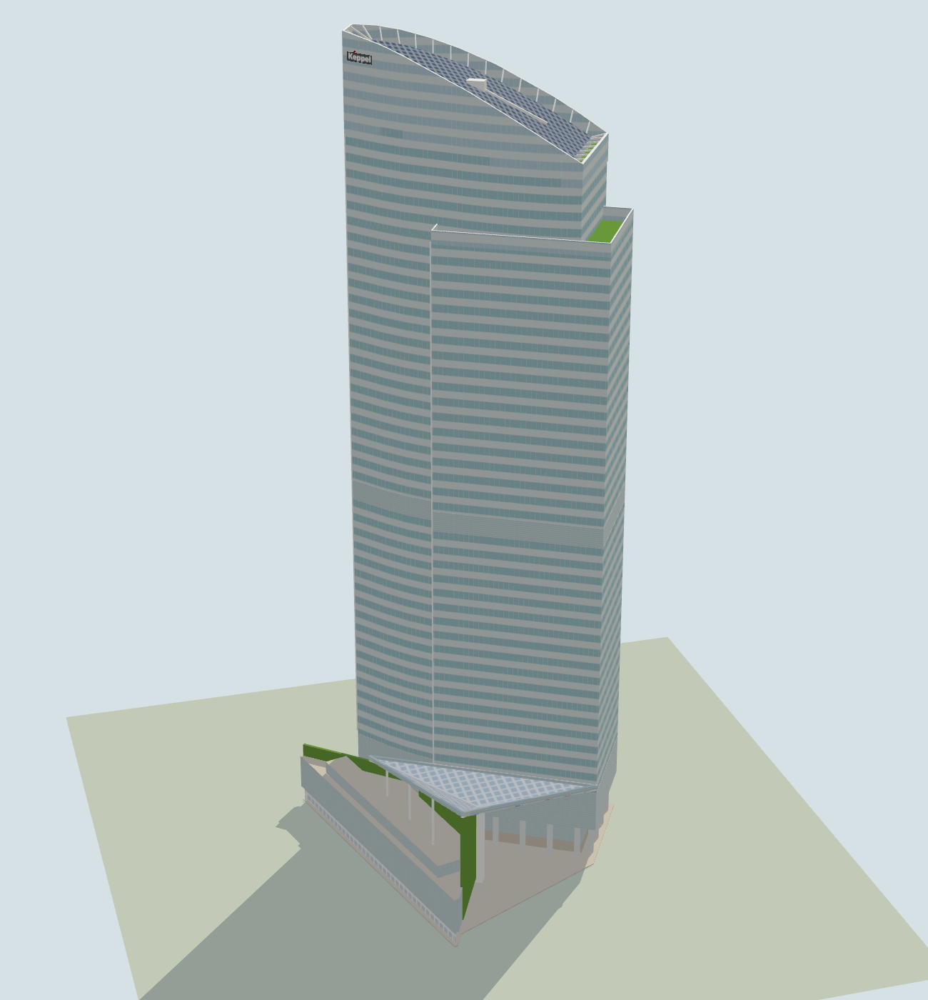
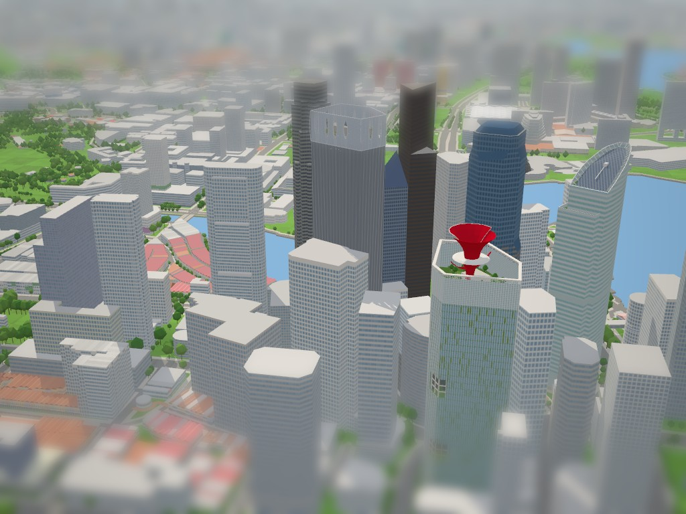

# Ocean Financial Centre model

Checklist SG-005. Built on `claude/building-checklist-progress-ceabc0` on 3 November 2026 with the landmark kit and the city's normal/Tiny material pairing. Program: `js/landmark-models/ocean-financial-centre.js`; tests: `tests/landmark-ocean-financial-centre.test.cjs`; Keppel's mark: `keppel` in `js/landmark-logos.js`.

## The building

Ocean Financial Centre, 10 Collyer Quay, was completed in 2011 for Keppel Land. It is 245 m and 43 storeys. The design architect was Pelli Clarke Pelli, and Architects 61 was the architect of record. The checklist brief named Peddle Thorp, but no source found links that firm to the building. The tower replaced the Ocean Building, on the corner where Collyer Quay turns from Raffles Quay toward Fullerton. Raffles Place lies to the west and The Arcade to the north.

What the sources and photographs establish:

- **Plan.** The tower is a sail in plan. Its face toward Raffles Place and the plaza is gently bowed, and its face along Collyer Quay is strongly bowed. Toward the bay it ends in a narrow face 9.4 m wide, and toward the south-west in a straight face. Architects 61 describe "two interlocking volumes": a lower slab wraps the plaza face and the south-west end.
- **Crown.** OSM tags the crown as a skillion falling 30 m toward 240°. Photographs from far off show a curve, not a straight cut. The top is nearly level at the bay end and falls more steeply toward the south-west, over about 30 m. Pelli Clarke Pelli describe a 25 m sky garden at the top. Tierra Design locate the gardens on floors 39–43, between the structure and the glass. The screen around them carries the same spandrel bands as the offices, over lighter glass. Inside is a roof of solar panels (about 400 m², the "large solar array"; it is on the roof, not the façade) with a window-cleaning crane, ringed by white steel trusses.
- **Façade.** Pale aqua glass is banded every storey by light anodised-aluminium spandrels, so the façade reads as horizontal stripes. The narrow ends toward the bay (the tower's and the slab's) carry white vertical fins. A louvred plant band runs above the lobby and another at mid-height.
- **Base.** Thick, polished stainless-steel round columns, about 1.8 m across and 12 m tall, are the base's dominant feature. They stand in front of a pale lobby wall: light grey-green glass with fine horizontal louvres behind it, over beige stone panels about 4 m high. Along Collyer Quay the tower overhangs a taxi drop-off behind the columns. In front of them, between the drive and the quay, a black granite plinth carries "Ocean Financial Centre" in white letters.
- **Plaza and canopy.** Between the tower and the car-park podium along The Arcade is a triangular public plaza, open to Raffles Place. A canopy of white and stained glass on a steel frame covers it. Architects 61 give its height as 27 m and describe it as shaped like a martini glass. Pelli Clarke Pelli give 42 m. In the aerial its three facets fold down to one point, and the photographs put a white glass-clad column there. The podium's faces to Raffles Place and to the plaza are the green wall, the largest in the world in 2013 (Guinness), and it rises to meet the canopy.
- **Signs.** Keppel's grey plate with a red stroke hangs on the crown near the bay end, on the bowed face and on the face toward Raffles Place. The building's name is on the granite plinth on Collyer Quay. ANZ's blue mark over its name hung on the narrow bay end in photographs from 2012–2015. ANZ moved its Singapore office to Marina One West Tower effective 19 October 2026 (checked 3 November 2026), so the model leaves its sign off.

## Sources

- [Wikipedia: Ocean Financial Centre](https://en.wikipedia.org/wiki/Ocean_Financial_Centre) (read 3 Nov 2026): 245 m roof, 43 floors, Pelli Clarke Pelli, Keppel Land, opened 2011, solar array.
- [CTBUH Skyscraper Center](https://www.skyscrapercenter.com/building/ocean-financial-centre/933): 245 m architectural top and tip, 43 floors, 2011; Pelli Clarke Pelli (design), Architects 61 (record).
- [Pelli Clarke Pelli's project text and drawings, on Divisare](https://divisare.com/projects/289292-pelli-clarke-pelli-architects-ocean-financial-centre): sail-like form, alternating glass and metal panels, 25 m sky garden, the 42 m canopy marking the entrance from Raffles Place. Includes the ground-floor plan (lobby, plaza, taxi drop-off) and site plan, and photographs by Tim Griffith, Benjamin Yu and Robert Such (2014). The rooftop photovoltaics photograph is the reference for the crown's roof.
- [Architects 61's project page](https://a61.com.sg/projects/ocean-financial-centre): two interlocking volumes, gently sloping crown, horizontal bands of anodised aluminium and glass, four levels of roof gardens, the 27 m "martini glass" canopy with translucent coloured panels, the green wall screening the car park, about 400 m² of photovoltaics on the roof. Photographs by Tim Nolan (2010, 2013): from Clifford Pier, from the Collyer Quay junction (day and dusk), the plaza, the lobby, and the canopy from below.
- [PR Newswire, 2011](https://www.prnewswire.com/news-releases/new-office-tower-by-pelli-clarke-pelli-architects-lights-up-singapore-128805728.html) and [Tierra Design](https://tierradesign.com.sg/projects/ocean-financial-centre/): the sky garden, gardens on floors 39–43, and the green wall on three sides of the car park.
- Wikimedia Commons, [Category:Ocean Financial Centre and Ocean Towers](https://commons.wikimedia.org/wiki/Category:Ocean_Financial_Centre_and_Ocean_Towers):
  - [20250903](https://commons.wikimedia.org/wiki/File:Ocean_Financial_Centre_20250903.jpg): from Raffles Place, west. The crown over the slab, Keppel's sign, the canopy's edge.
  - [27279296302](https://commons.wikimedia.org/wiki/File:Ocean_Financial_Centre_(27279296302).jpg): the crown and the slab's parapet, from the west.
  - [20121027](https://commons.wikimedia.org/wiki/File:One_Marina_Boulevard,_Ocean_Financial_Centre,_OUE_Bayfront,_Customs_House_and_The_Fullerton_Bay_Hotel,_Singapore_-_20121027.jpg): from the east. The crown's fall measures about 31 m.
  - [20121015](https://commons.wikimedia.org/wiki/File:The_Sail_@_Marina_Bay,_One_Marina_Boulevard,_Ocean_Financial_Centre_and_OUE_Bayfront,_Singapore_-_20121015.jpg): from the south-east. Keppel on the bowed face, ANZ on the bay end.
  - [Bayfront, view west](https://commons.wikimedia.org/wiki/File:Bayfront_-_View_W_to_Fullerton_Road_skyline.jpg).
  - [Green wall, 20150327](https://commons.wikimedia.org/wiki/File:Green_wall,_Ocean_Financial_Centre,_Singapore_-_20150327.jpg): the green wall rising to the canopy, the white column, the canopy's west edge.
  - [Raining colour](https://commons.wikimedia.org/wiki/File:Raining_colour_(27464534502).jpg): the plaza.
  - [11Jul2026](https://commons.wikimedia.org/wiki/File:Ocean_Financial_Centre_11Jul2026.jpg): the Collyer Quay frontage, the reference for the base. It shows the stainless columns, the louvred glass over beige stone behind them, and the black granite plinth with the building's name.
- [Esri World Imagery](https://www.arcgis.com/home/item.html?id=10df2279f9684e4a9f6a7f08febac2a9), zoom-19 tiles with the OSM outlines drawn over them. The roof leans about 60 m east-south-east, but it shows the boat-shaped crown with its white frame, solar panels and crane. At the canopy's low height it shows the folds and their meeting point.
- Keppel's mark: [Keppel Ltd logo.svg](https://commons.wikimedia.org/wiki/File:Keppel_Ltd_logo.svg), public domain on Commons (a trademark, below the threshold of originality).
- ANZ's tenancy:
  - A [January 2026 report](https://www.freemalaysiatoday.com/category/business/2026/01/28/anz-to-consolidate-singapore-staff-in-one-office), citing Bloomberg, said ANZ would move its Singapore staff to Marina One as its lease here ended.
  - [ANZ Singapore's own page](https://www.anz.com/singapore/), read 3 November 2026, announces the relocation to 9 Straits View, Marina One West Tower, Level 19, effective 19 October 2026. ANZ's [institutional contact page](https://institutional.anz.com/markets/singapore/en/contact) still gives the old address.
  - I found no report or photograph of the sign coming down.

Reference photographs are kept outside the repository.

## Replaced OSM ways

All six are hidden in `tools/city/cities/singapore.mjs`, and the hide list is unchanged:

| Way | Tags | Used for |
| --- | --- | --- |
| [172915346](https://www.openstreetmap.org/way/172915346) | `building=office`, 242 m, the whole site | The tower-and-slab footprint (its arc from the slab's west corner round the bowed face), the link's corners, the paving |
| [46595387](https://www.openstreetmap.org/way/46595387) | `building:part`, 43 levels, 245 m, skillion 240° / 30 m | The tower |
| [1566589608](https://www.openstreetmap.org/way/1566589608) | `building:part`, 40 levels, 195 m | The slab (parapet faces) |
| [1566589605](https://www.openstreetmap.org/way/1566589605) | `building:part`, 4 levels | The podium (car park over shops) |
| [1566589606](https://www.openstreetmap.org/way/1566589606) | `building:part`, levels 4–5, 20 m | The podium's top storey |
| [1566589607](https://www.openstreetmap.org/way/1566589607) | `building:part=roof`, 15 m | The canopy's corners. Its 15 m tag is not used: the canopy is 25–40 m high. |

The Arcade (171999284, 172915362, 1566589603, 1566589604) is left to the city, and nothing is built over it.

## Frame and drawing

The program works in the city frame about the anchor. Two axes are taken from the tower: `u` along bearing 62°, from the south-west end to the bay end, and `v` across it toward the plaza (332°). The bay end and the south-west end are both square to `u`. OSM's skillion bearing of 240° is the same line reversed, within 2°.

Corners come from the mapped rings, by the nearest mapped point to a position given in metres east and north of the anchor. The program throws if none lies within 3 m. These corners are the slab's west corner and north-east end, the canopy's three corners, the podium's corners and the link's corners. The tower-and-slab footprint is the outline's arc between the slab's two ends.

## Massing

| Mass | Plan | Heights (m) |
| --- | --- | --- |
| Tower | Mapped ring, 71 m along `u`, 9.4 m bay end | 245 at the bay end (published, mapped). The crown falls 30 m to 215 at the south-west end (fall mapped and measured from the 2012 photograph from the east; the curve `30 t^1.5` is estimated). |
| Crown | Glass screen 0.65 m thick, 0.3 m proud of the offices; garden storeys set 4 m in | The offices stop 24 m under the top at the bay end and 4 m at the south-west end (estimated; Pelli Clarke Pelli: 25 m sky garden). The solar roof is 3 m under the screen's top (estimated). Trusses about every 5 m; the crane is kept under the screen's top. |
| Slab | Mapped ring: a 9 m end block and a 4.6–6.9 m strip along the plaza face | Roof 191, glass parapet to 195 (195 mapped; parapet from photographs) |
| Base (tower and slab) | Lobby wall 5 m in, cut back 11 m from the bowed face for the drop-off. Polished stainless columns 1.8 m round (16 sides), 2.4 m in, about 8.5 m apart. Black granite plinth 14 × 0.8 m at the middle of the bowed face, with the name in white (panel 1.2 m high, letters about 0.6 m). | Beige stone 0–3.8, louvred grey-green glass 3.8–12, columns 0–12, plinth 0–1.6 (all estimated from the July 2026 photograph). Louvred plant floors 12–25 and 105–111 (estimated from Tim Nolan's photograph from the junction). |
| Fins | 4 on the tower's bay end, 3 on the slab's | 25 up to the crown's top and to the slab's roof |
| Podium | Mapped rings | Shops 0–5 (set in 1.5 m), car park 5–16 (4 levels mapped), top storey 16–20 (mapped) |
| Green wall | 0.9 m thick, 0.3 m proud, in pieces of 4 m or less | From 5 m to the canopy's underside on the faces to Raffles Place and the plaza (about 25–40); 20 along the passage to Collyer Quay (estimated) |
| Link | The outline's notch between the slab's end and the podium | 14–21 (estimated from a photograph of the passage) |
| Canopy | Mapped triangle in three facets folded to one point, 6.5 m beyond the podium's corner along its west face | North corner 40, south-west and east corners 27, the fold's foot 25 (estimated, between Architects 61's 27 m and Pelli Clarke Pelli's 42 m). White column 3 m square; white ribs on the folds, dark steel edges; 3 posts from the podium's roof to the north edge. |

Colours, from daylight photographs:

- Tower: glass `#9cc4c1`, spandrels `#d5dedc`, the crown's lighter glass `#b9d4d4`, solar panels `#24375a`.
- Base: louvred glass, light grey-green `#ccd8d5` over `#bcd0cd`, shared with the plant floors and the podium's screens. Beige stone (`#cdc4b3`, the same material as the paving). Stainless columns `#dfe2e1`, slightly metallic. Black granite `#1f2223`, glossy.
- Green wall `#6a9a3c`. The podium's shopfronts are white-framed glass.
- Canopy: a white lattice on top. Underneath, frosted white panes with red, blue and yellow ones scattered among them, the strips taking each colour in turn, so the colours mix across the underside.

## Collision

The tower and slab are solid from 12 m up, with the crown in six slices to the roofline. The lobby, columns, plinth, podium shops and canopy column collide at the ground. The podium, green walls and link have explicit volumes. The canopy is solid in strips along its level lines, from just under its stepped soffit to its roof.

The plaza, the drop-off under the bowed face, and the passage between the tower and the podium are clear to walk and fly through.

## Inspect and rebuild

```text
http://localhost:8021/tools/landmark-preview.html?model=ocean-financial-centre&view=all
http://localhost:8021/tools/landmark-preview.html?model=ocean-financial-centre&view=e&look=day
http://localhost:8021/tools/landmark-preview.html?model=ocean-financial-centre&view=top
http://localhost:8021/?look=tiny&at=ocean-financial-centre&camera=map
```

```powershell
node --test tests/landmark-ocean-financial-centre.test.cjs
node --test tests/landmark-kit.test.cjs tests/landmark-models.test.cjs tests/singapore-landmarks.test.mjs
```

The hide list is unchanged, so the geodata needs no rebuild.

## Verification

- `tests/landmark-ocean-financial-centre.test.cjs`: 7 tests pass.
  - The six replaced ways, and none of The Arcade's.
  - 245 m, built in under 500 ms, nothing over The Arcade.
  - The crown at 245 m at the bay end and about 215 m at the south-west end, curved (the middle of the bowed face well above the straight line). The slab's roof is under its 195 m parapet; screen, gardens and fins are present.
  - The plaza, drop-off and passage are open in geometry and collision. The canopy is over the plaza between 24 and 42 m and stops descent. The column reaches the canopy's low point. The green wall rises under the high corner. The tower, crown, slab, link, podium and the overhang above the drop-off are solid.
  - Keppel's two marks hang on walls on the crown, under its top. The name hangs on the plinth's face, within its height. There is no ANZ sign.
  - The columns are about 1.8 m round with at least 16 sides, and stand outside the lobby wall. The plinth is low.
  - Budgets: about 3,500 triangles, 15 batches (two of them signs), no coplanar flicker, finite.
- Rendered in the preview (Tiny and day looks) and compared with the photographs:
  - From across Collyer Quay (July 2026): the thick silver columns before the louvred glass over beige stone, the black plinth with the name in front.
  - From the east (2012) and the south-east (The Sail, 2012): the crown's curved fall, Keppel near the high end.
  - From across the bay to the north-north-east (Pelli Clarke Pelli, Tim Nolan): the straight bay end, the curve falling away, the lower slab at the right with its white fins.
  - From Raffles Place (2025): the slab in front of the crown.
  - From the plaza (2015): the green wall rising to the canopy's descending edge, the white column, the colonnade and louvres.
  - From above, against the aerial and the rooftop photograph: the white rim and trusses round the solar roof, the canopy's folds.



- Checked together in the live city on 3 November 2026 (WebGPU, Tiny look, map camera from the south-south-west of
  CapitaSpring): the three model programs build without console errors or flicker warnings (CapitaSpring 43,932,
  Ocean Financial Centre 3,533 and CapitaGreen 8,372 triangles), no generic extrusion remains on any of the three sites,
  and The Arcade, 18 Robinson and the Market Street and Malacca Street neighbours still stand. The full suite
  (`node --test 'tests/**/*.test.*'`) passes 456 of 457 on this Windows checkout; the one failure is the
  pre-existing tile worker test in `tests/city-tiles`, which these models do not touch.



## Limitations

- **Crown.** The curve's exact profile, the crown's depth and the solar roof's height are read from photographs. The screen's foot steps a storey at a time, hidden in a spandrel band.
- **Tower and slab.** The tower's narrow bay end is modelled flush with fins. Photographs from the south hint at a recessed slot at its corner. The two louvred plant bands are placed from one shift-lens photograph, and a second photograph put the mid-height band about 15 m lower.
- **Canopy.** Its fold point, its 40 m north corner and the posts under its north edge are interpretations: no section was found. The triangle is simplified to the mapped corners, without the small jog at its north corner. Its underside has three of the stained glass's colours (red, blue, yellow; the green and orange panes are left out to keep within the batch budget), in rectangular panes rather than the real triangles. The stepped soffit approximates a smooth underside, because the kit has no thin tilted plate.
- **Base.** The columns' spacing and the lobby wall's setback are estimated from one photograph, and the plinth's place along the bowed face from that photograph and the ground-floor plan. The lobby's warm-lit entrance and the planting round the plinth are not modelled. The plinth's lettering is a system font close to the real one.
- **Podium.** Its height follows OSM (4 levels and a top storey to 20 m). The grey louvred mass seen behind the canopy from Raffles Place may stand higher.
- **Not modelled.** The plaza sculptures (Kapoor's steel spheres, Plensa's *Singapore Soul*), the LED lighting and the passage under the slab's south-west end.
- **ANZ sign.** It hung on the bay end in photographs from 2012–2015. It is left off because ANZ moved to Marina One West Tower effective 19 October 2026, per ANZ Singapore's own page, read 3 November 2026. No source says whether the sign itself has come down yet. If later photographs show it still up, the mark can be redrawn from Commons' public-domain `ANZ-Logo-2009.svg`.
