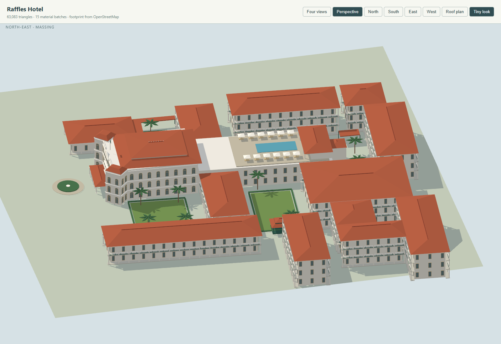
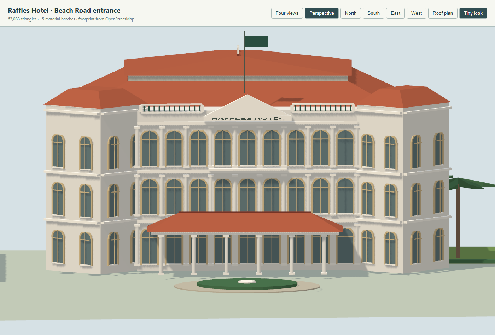

# Raffles Hotel

The model covers the hotel between Beach Road, Bras Basah Road, North Bridge Road and Seah Street, including Raffles Arcade. It is distinct from Raffles City and Raffles Place MRT.

## Reference drawing

- [Hotel floor plans, levels 1–3](https://ttgplanner.2017.ttgasia.com/wp-content/uploads/sites/4/2022/07/RHS-Hotel-Floorplan-Level-1-to-3.pdf): hotel-issued visitor plan hosted by TTG; court locations, wings, Arcade and rooftop pool. Dining labels are historical; this is an architectural reference, not current tenant data.
- [Aedas restoration project](https://www.aedas.com/en/project/raffles-hotel-singapore/): Beach Road façade, Lawn verandas and rooftop pool photographs, credited to Raffles Hotel Singapore. Used for proportions and colours; photographs are not included in the repository.
- [Raffles' history](https://www.raffles.com/singapore/about/): development of the main building, Palm Court Wing and Arcade.
- OpenStreetMap building extract at `tools/data/singapore/osm_buildings.json`, © OpenStreetMap contributors, ODbL: way 254815862 (Bar & Billiard Room), relation 3413910 (main building/rear wing) and relation 3413596 (Arcade), plus the separate suite-wing parts listed in the city configuration.

The local drawing uses metres along true bearing 37.1° (right on the hotel plan) and 307.1° (back toward North Bridge Road). Its approximate origin is longitude 103.854565°, latitude 1.294280°. The model recovers that origin from way 254815862, so its placement follows the city's rotated frame and anchor. The main building's slightly skewed outline and projecting corners are retained in the drawing. The Arcade is decomposed into wings around its mapped inner court.

## What matters at map scale

White three-storey Beach Road front; recessed cream windows; real round arch profiles; projecting corner pavilions; central pediment, flagpole and low red-roofed carriage porch. The upper red roofs have separate hips, eaves and ridge crests. The lower suite wings have open verandas, repeated columns and dark green balustrades. The pool occupies the rear main building's third-storey terrace. Courts have low garden surfaces, paths, palms and a Lawn pavilion.

Mapped height tags conflict with the visible storeys (for example, the low Bar & Billiard Room is tagged 14 m and one level). Roof/wall elevations, the rear stair-link height, column profiles, tiny cresting, planting and furniture are visual estimates from the plans and photographs, not a measured survey or an interior model. Roof tiles are suggested by ridges and colour, rather than individually modelled. The Arcade's complex service/ballroom roofs are simplified while preserving its footprint and open square; its southeastern Casuarina wing has three storeys, matching the third-storey visitor plan. Small mapped covered links and the Lawn pavilion retain their source locations and clear headroom below their roofs.

## Verification

Use the shared [landmark modelling guide](landmark-modeling/README.md). The model tests exercise the real generated anchor and geometry, including courtyard and roof collision probes. Preview with `tools/landmark-preview.html?model=raffles-hotel`; in the city use `?look=tiny&at=raffles-hotel&camera=map`.

The finished model has 63,083 triangles across 15 merged material batches, with no coplanar flicker. It was checked in Tiny and daylight looks, with WebGL and WebGPU previews and the full city loaded. Reference-based proportions and the documented estimates still limit architectural accuracy.

