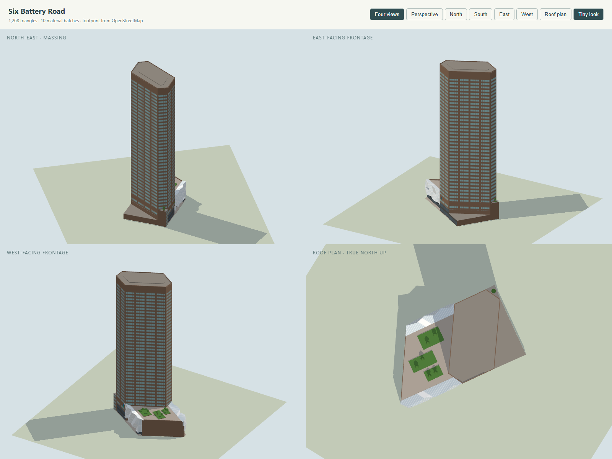

# Six Battery Road model

Checklist **SG-007**. Program: `js/landmark-models/six-battery-road.js`; tests: `tests/landmark-six-battery-road.test.cjs`. Built on 3 November 2026 with the landmark kit and the city's normal/Tiny material pairing, replacing a two-prism placeholder.

Six Battery Road, Raffles Place, is the former Standard Chartered Bank Building. It was designed by P&T Group with RSP Architects Planners & Engineers (Meinhardt, engineers), completed in 1983 and inaugurated on 24 October 1984. CapitaLand Integrated Commercial Trust owns it. The tower stands between the Singapore River (the Boat Quay promenade, north-west), Battery Road (south-east) and the Bank of China (east). Its podium runs west to Bonham Street. DP Architects re-clad the podium in 2022 and won the Architecture MasterPrize 2023 for it. Standard Chartered, the anchor tenant for over 30 years, moved its offices out in 2022 but keeps a branch off the new linkway and its marks on the building.

## References and interpretation

- [Wikipedia](https://en.wikipedia.org/wiki/Six_Battery_Road), read 3 November 2026: roof at 174 m, 44 floors above ground and 3 below, completed 1984, inaugurated on 24 October 1984, P&T Group and RSP, Meinhardt, a "baltic brown granite" exterior, and floors 1, 20, 21, 43 and 44 renovated in 2002. [List of tallest buildings in Singapore](https://en.wikipedia.org/wiki/List_of_tallest_buildings_in_Singapore): 174 m, 44 floors, 1984.
- [CTBUH Skyscraper Center](https://www.skyscrapercenter.com/building/6-battery-road/2578), read 3 November 2026: 174 m architectural and tip height, 44 floors, completed 1983, P & T Group, Meinhardt, formerly the Standard Chartered Bank building.
- [CapitaLand's leasing page](https://www.capitaland.com/sg/en/lease/commercial-space-listing/six-battery-road.html), read 3 November 2026. Facts: 42 storeys, 66,408 m² gross and 46,004 m² lettable, 162 car park lots, a "tessellated glass façade and riverside pavilion", the Rainforest Rhapsody indoor garden, a linkway to the river promenade, BCA Green Mark Platinum 2010, Architecture MasterPrize 2023. Photographs, from before the 2022 works:
  - *Six-Battery-Road-Hero*: from the corner of Bonham Street and Battery Road. Shows the west and south-west faces, the plain flat-topped crown, and the old granite podium with Standard Chartered's mark.
  - *-Night-Facade*: Battery Road at night. Shows the south-west face, the porte-cochère, and the Bank of China visible down to its lower floors beyond the low wedge east of the tower.
  - *-Signage*: the name in letters on the porte-cochère's fascia.
- DP Architects, [news of the MasterPrize win](https://www.dpa.com.sg/news/architecture-masterprize-2023-dpa-takes-home-one-win-and-four-honorable-mentions/) (8 March 2024). The design was led by Angelene Chan with DP Façade and DP Lighting. Translucent, fritted glass triangles "respond to the hexagonal shape" of the tower and wrap the two main frontages and the roof. A through-block link runs at ground level from Battery Road to the river. Its carousel *01A* and *01B* show the river frontage by day and by night.
- [Architecture MasterPrize entry](https://architectureprize.com/winners/winner.php?id=7005), read 3 November 2026. Its eleven photographs (DP Architects, after 2022) are the main references for the present podium:
  - IMG 8: the Battery Road frontage square on. The skin's top, its foot over the recessed glazed ground floor and its full width were measured on it against the tower's storeys.
  - IMG 6: looking west along Battery Road. Shows the skin's prow at Bonham Street, and Standard Chartered's mark above the porte-cochère on the tower's Battery Road face.
  - IMG 3: the same frontage at night.
  - IMG 11 and IMG 5: the river frontage. Show the tower's river face with its two-storey lobby, a granite storey with one row of windows, Standard Chartered's mark on a blank storey, the skin with the linkway's door and the riverside pavilion, and the five-storey block east of the tower.
  - IMG 10: the roof garden inside the skin's sloping glass rim.
  - IMG 9, 7 and 4: the steel frame, the dotted frit, and the linkway's ceiling.
- The Edge Singapore, ["Banking hall turned business hub"](https://sg.finance.yahoo.com/news/banking-hall-turned-business-hub-220000957.html) (25 January 2023): a 42-storey "red granite" building. Standard Chartered was the anchor for more than 30 years and moved out the previous year.
- [Standard Chartered](https://www.sc.com/sg/important-information/a-warm-welcome-to-our-new-battery-road-branch/): the branch is on level 1, off the linkway.
- Wikimedia Commons, [Category:6 Battery Road](https://commons.wikimedia.org/wiki/Category:6_Battery_Road):
  - [Six Battery Road viewed from Elgin Bridge.jpg](https://commons.wikimedia.org/wiki/File:Six_Battery_Road_viewed_from_Elgin_Bridge.jpg) (Zairon, 3 November 2015): the river and west faces almost square on. The window groups, the storey, the crown band and the flat roof were measured on it, and the colours sampled. It also shows CapitaLand's name on the crown's river face, and the old podium with Standard Chartered's marks on its Bonham Street face.
  - [Six Battery Road.JPG](https://commons.wikimedia.org/wiki/File:Six_Battery_Road.JPG) (Terence Ong, May 2006) and [Six Battery Road 3.JPG](https://commons.wikimedia.org/wiki/File:Six_Battery_Road_3.JPG) (September 2006): the faces from below. The corners are plain 120° arrises: no steps or serrations.
  - [Maybank Tower, Bank Of China and 6 Battery Road.JPG](https://commons.wikimedia.org/wiki/File:Maybank_Tower,_Bank_Of_China_and_6_Battery_Road.JPG) (Terence Ong, April 2006): CapitaLand's name on the crown's eastern face.
  - [SingaporeCBD9.jpg](https://commons.wikimedia.org/wiki/File:SingaporeCBD9.jpg) (Kueline Seria, 8 October 2021): from Marina Bay. The crown's east face then read "CapitaCommercial Trust".
- [Esri World Imagery](https://www.arcgis.com/home/item.html?id=10df2279f9684e4a9f6a7f08febac2a9) tiles at zoom 19 with the OSM outlines overlaid. They show white glass facets along the river edge of the podium's roof. The tower leans out of its footprint and most of the site lies in shadow, so they settle little else.
- OpenStreetMap streets (local extract, 25 October 2026):
  - Battery Road (479332226) along the south-east edge;
  - Bonham Street (670354712, 670354713) along the west;
  - the Boat Quay promenade (692203225) along the north-west;
  - the drop-off lane (1511182464) in front of the tower's Battery Road face, under the canopy 1511182439.

The reference photographs stay outside the repository.

### OpenStreetMap ways replaced

| Way | Tags | Use |
| --- | --- | --- |
| [172916311](https://www.openstreetmap.org/way/172916311) | "Six Battery Road", `building=yes`, 4 levels, 12 m, Kaart ground survey 2017 | the site's outline. The podium and the wedges follow its corners: P1 and P2 at the Bank of China, P3 at the river and Bonham Street, P4–P5 the chamfer at Battery Road. |
| [106193384](https://www.openstreetmap.org/way/106193384) | `building:part`, 42 levels, 174 m, colour `#908174`, from the ground | the tower. Its six points are averaged for the drawing's origin; its faces are matched within 0.8 m. |

Both are hidden in `tools/city/cities/singapore.mjs`. Neighbours stay the city's: the Bank of China's buildings (106193390, 172916312, 1075238474–78), Maybank Tower, Singapore Land Tower, MYP Centre, HSBC and UOB Plaza.

**Hide-list note:** way [1511182439](https://www.openstreetmap.org/way/1511182439) (`building=roof`, layer 1) is Six Battery Road's porte-cochère canopy over the drop-off lane, outside the outline along the tower's Battery Road face. It is not hidden, so the city still draws it as a generic slab at 2.6–3.2 m. The photographs put the real canopy at about 7 m, deep, timber-soffited, with Standard Chartered's mark above it. The model leaves it to the city. Hiding the way and modelling the canopy is a follow-up.

## Frame and drawing

The program draws in metres about the mapped tower's middle (the mean of its six points):

- `u` runs along the long faces toward the river end (bearing 5°);
- `v` runs across toward the east face (95°).

The tower is a regular drawing of the mapped hexagon. Every corner is 120°. The sides are 4, 1, 2, 4, 1 and 2 bays of 11.35 m:

| Face (outward bearing) | Drawn | Mapped |
| --- | --- | --- |
| west (275°) | 45.4 m, four window groups | 45.5 m |
| south-west (215°) | 11.35 m, one group | 11.5 m |
| Battery Road (155°) | 22.7 m, two groups | 23.0 m |
| east (95°) | 45.4 m, four groups | 45.2 m |
| north-east (35°) | 11.35 m, one group | 12.2 m |
| river (335°) | 22.7 m, two groups | 22.4 m |

The hexagon is 29.5 m between the long faces and 49.1 m between the river and Battery Road faces. Its area is 1,562 m² (mapped 1,590).

The tower's river face lies on the outline's river edge and its Battery Road face on the Battery Road edge. Its east corner touches the boundary with the Bank of China. The rest of the outline (3,771 m²) is drawn as three pieces:

- the podium west of the tower to Bonham Street, with 34 m of river frontage and 39 m on Battery Road;
- a 32 m² wedge on the river between the tower's north-east face and the Bank of China;
- a 449 m² wedge on Battery Road between the tower's east face and the Bank of China.

The tower is not stepped. The checklist's "stepped granite/glass massing" is not borne out by any photograph from 2006 to 2023: the shaft rises sheer from the ground to a flat roof. The steps in the massing are the podium (22.5 m), the river block (19.75 m), the low east block (6.5 m) and the tower (174 m).

## Massing

| Mass | Heights (m) | Basis |
| --- | --- | --- |
| Tower lobbies: river and Battery Road faces glazed, 0.6 m behind the faces above | 0–11 | IMG 11 and IMG 5 (river), IMG 6 and IMG 3 (Battery Road); estimated against the storeys |
| One storey of windows (row at 13–14.9) | 11–15.2 | IMG 11 |
| Blank granite storey, Standard Chartered's mark on it toward the river and Battery Road | 15.2–20.6 | IMG 11, IMG 6 |
| Shaft: 37 rows of window groups (5 panes, half a storey high) between granite piers, on a 3.95 m storey | 20.6–165.1 | 174 m over 44 floors; Elgin Bridge 2015 shows 37 rows over the podium, windows 0.49 of the storey (rows 61.5 px apart, 30 px tall) |
| Crown: plain granite, two plant floors, no setback | 165.1–173.2 | Elgin Bridge 2015 (about 9 m from the top row to the roof edge at the same scale) |
| Parapet round the flat roof; a low plant box | 173.2–174 | 174 m published (Wikipedia, CTBUH) and mapped |
| Podium core: glazed ground floor 4 m behind the river edge and 3 m behind Battery Road's, plain granite to Bonham Street | 0–19.5 | IMG 8, IMG 11; Bonham Street face as in the 2015 photograph |
| Skin on Battery Road: two rows of folded glass over the recessed ground floor | 7.2–14.5–22.5 | IMG 8 (frontal; tower storeys for scale), IMG 6 |
| Skin on the river: down to 4.5 m, lifted to 8.5 m over the linkway's door 3.5–9.5 m from the tower | 4.5 (8.5)–13–22.5 | IMG 11, IMG 5, DPA 01A |
| Skin's upper rows slope inward from the 22.5 m rim to 19.7 m, 6 m in | 13/14.5–22.5 | IMG 10 (the glass roof rising toward the frontages), aerial |
| Roof garden: three planted beds, six small trees, a granite parapet to Bonham Street | 19.5–25 | IMG 10; layout estimated |
| Riverside pavilion: glass box under a folded white roof, under the skin's west end | 0.32–3.8 | IMG 5, IMG 11, DPA 01A; size estimated |
| River block (north-east wedge): granite with windows to the river, a tree on its roof | 0–19.75 | IMG 11 (about a storey under the skin's top) |
| East block (Battery Road wedge): glazed toward the street, flat roof | 0–6.5 | estimated: the night photographs show the Bank of China's lower floors over it, and a glazed lobby beside the drive |

The skin's folds are modelled as stations about 6 m apart along each frontage. At the foot, the fold and the top of each row, each station is pushed out of (≤ 1 m) or into (≤ 1.5 m) the outline. Each panel then breaks into two triangles tilted up to 20°.

## Colours and signs

Colours were sampled from the daylight photographs: Elgin Bridge 2015 (overcast) and IMG 8 and IMG 11 (sun). Sampled values:

- granite in sun: `#664f3c`–`#705541`;
- granite overcast: `#60584f`;
- windows: `#2a4344` up close, `#3b6c65` in reflection, pale green from afar;
- skin: `#949c9a` in shade, `#bac2c2` in light.

The OSM colour `#908174` was taken as a hint only.

| Element | Colour |
| --- | --- |
| Granite (tower, podium's Bonham face, blocks) | warm brown `#7a6352` |
| Windows | green-tinted `#7aa8a4` (blended toward the sky in the Tiny look) |
| Lobbies | dark glass `#2e3c44` in `#4b4945` frames |
| Skin | frosted `#e0e6e6` panes 1.25 m wide between `#f6f7f7` joints |
| Roofs | `#8d877f` |
| Paving | `#aca398` |
| Pavilion roof | `#eef1f1` |

Signs, both hung with `kit.hang` on the tower's blank storey and under its top:

- Standard Chartered's mark, 4.4 m tall, on the river face about 3 m from its west corner, as IMG 11 and IMG 5 show it;
- the same mark, 4.8 m tall, on the Battery Road face near its west end above the porte-cochère, as IMG 6 and IMG 3 show it.

The crown carries no sign in the model. It showed CapitaLand's name in 2006 and 2015 and "CapitaCommercial Trust" in October 2021, but no photograph after 2021 shows what it reads now.

Collision:

- The tower's pieces, the podium's core, both wedges and every skin row have explicit volumes.
- Left open: the walks under the skin on both frontages (paved at 0.32 m over the city's lawn), the river door, and the pavements.



## Inspect and rebuild

```text
http://localhost:8001/tools/landmark-preview.html?model=six-battery-road&view=all
http://localhost:8001/tools/landmark-preview.html?model=six-battery-road&view=ne&look=day
http://localhost:8001/tools/landmark-preview.html?model=six-battery-road&view=s&focus=skin
http://localhost:8001/tools/landmark-preview.html?model=six-battery-road&view=n&focus=skin
http://localhost:8001/tools/landmark-preview.html?model=six-battery-road&view=e&focus=east
http://localhost:8001/?look=tiny&at=six-battery-road&camera=map
```

```powershell
node --test tests/landmark-six-battery-road.test.cjs
```

The tests check:

- the two replaced ways, the tower part's mapped 42 levels and 174 m, and that the neighbours stay the city's;
- the 174 m height, standing on the ground, building in under 500 ms, every part within 1.5 m of the outline;
- the mapped plan's 120° corners;
- the tower's five pieces as one unbroken stack, each on the mapped hexagon within 0.8 m (no setbacks), its sides 4 : 1 : 2 bays, a crown band of 7.5–10 m, the flat roof and parapet at 174 m;
- the skin over Battery Road's recessed, paved walk, folded (its foot and top rings differ), the river door open to 8 m, the rim higher than the garden's deck, trees on the roof, the east block at 6.5 m and the river block at 19.75 m, the pavilion under 4.5 m, the podium under the tower's first rows;
- the walks and the door free to walk under but solid to fly into, the pavements free at 2, 60 and 170 m, the podium solid under its garden;
- that every raised part rests on something, the parapet on the crown;
- the two Standard Chartered marks on tower walls facing the river and Battery Road, under their tops, between 14 and 21 m;
- the budgets, finite geometry, no coplanar flicker, and the tower solid from 1.5 to 173 m.

## Verification

- `node --test tests/landmark-six-battery-road.test.cjs`: 8 of 8 pass.
- `node --test tests/landmark-six-battery-road.test.cjs tests/landmark-kit.test.cjs tests/landmark-models.test.cjs tests/singapore-landmarks.test.mjs tests/city-geodata.test.mjs`: 90 of 90 pass.
- 1,268 triangles in 10 material batches (one of them the sign), no coplanar flicker, built in under 10 ms in node.
- Rendered in the preview (headless Chrome, WebGL, SwiftShader), Tiny and day looks: the four views, the roof plan, north and south views, the skin from the south, north and west, and the east block.
- Compared with:
  - Elgin Bridge 2015, set beside the preview's west view: the window groups, the crown band, the proportions;
  - IMG 11, beside the north view: the river face's lobby, the blank storey and mark, the skin, the door, the pavilion and the river block;
  - IMG 8 and IMG 6, beside the south view: the skin over the recessed ground floor and the mark over the porte-cochère.
- Not checked here: the live city (headless Chrome cannot load it) and WebGPU.

## Limitations

- The skin is a few large folded panels per row. The real one is a finer tessellation of triangles with lit joints and a dotted frit; the frit is not drawn.
- The skin's ends at Bonham Street are cut square to the street. The real skin turns the corner at Battery Road as a prow (IMG 6). The skin's extent along Bonham Street is uncertain. A brown granite block seen beyond its west end in IMG 8 and IMG 11 is taken to stand across Bonham Street.
- The roof garden's layout, the rooftop pavilions and the glass roof's real geometry are estimates from one photograph (IMG 10).
- The east block's height and use (a lobby beside the drive, perhaps the car park ramp) are inferred from night photographs. No photograph shows it square on.
- The porte-cochère is the city's generic slab at about 3 m (way 1511182439, see the hide-list note). The real canopy is at about 7 m with the name "Six Battery Road" on its fascia; that name sign is therefore not hung.
- The crown's faint louvre panels and the roof's maintenance gantry are left out. Two darker rows on the south-west face (about levels 27–28) in CapitaLand's photograph are not modelled.
- The Rainforest Rhapsody garden and the linkway are interior and are not modelled.
