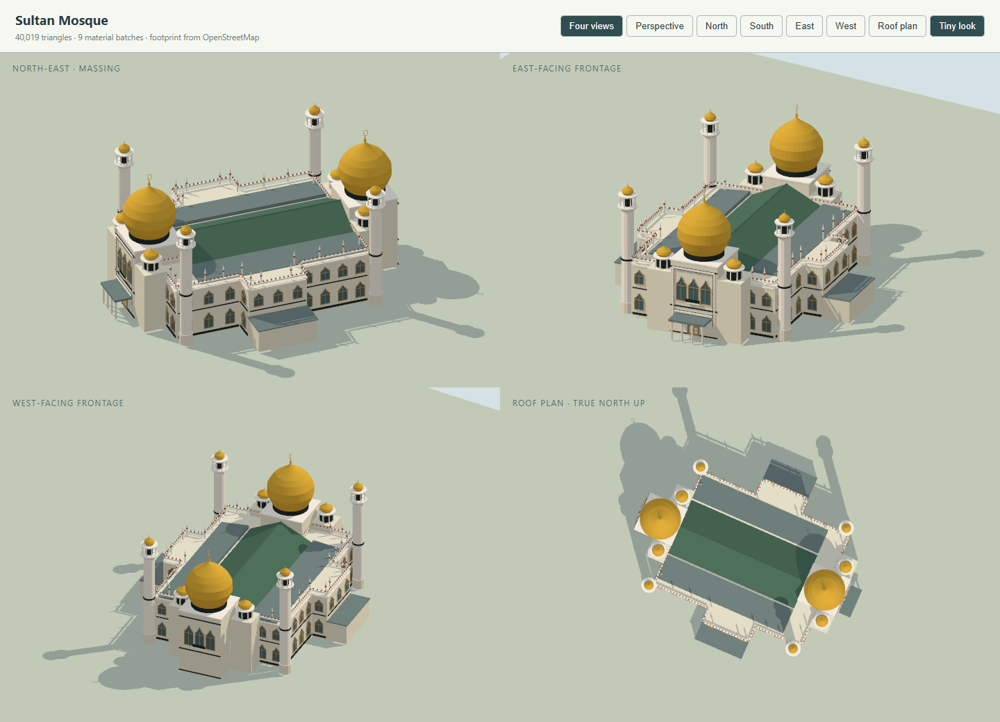
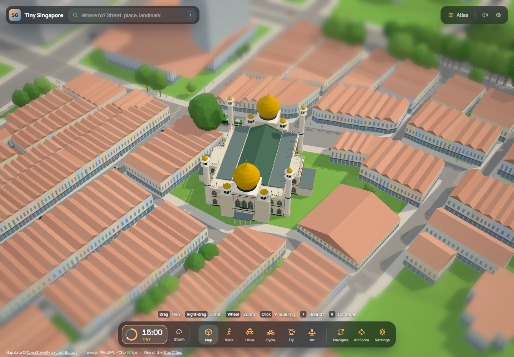

# SG-242 — Sultan Mosque

Model scope: the historic prayer hall at 3 Muscat Street, Kampong Gelam. Assigned to Codex session `18e5` on 2026-11-03; the separate Annexe House remains a generic mapped building. The checklist and shared registration are maintained by the parent integration task.

## Sources and reference interpretation

References accessed 2026-11-03:

- [National Heritage Board, Sultan Mosque](https://www.roots.gov.sg/places/places-landing/Places/national-monuments/sultan-mosque): identifies the two golden ogee domes, entrance foyer, royal mausoleum, corner minarets, arches and merlon cresting. The page's text was available in search; its live page presented a JavaScript verification challenge.
- [Singapore Government SG101, Sultan Mosque, 27 June 2023](https://www.sg101.gov.sg/resources/archives/heritage-sultan-mosque/): confirms Muscat Street / North Bridge Road elevations, four-column entrance foyer, glass bottle bands under the two domes, and the distinct 1993 annexe.
- [NLB BiblioAsia, April–June 2013, pp. 16–23](https://biblioasia.nlb.gov.sg/files/pdf/Biblioasia%20Apr-Jun%202013.pdf), “The Invention of a Tradition: Indo-Saracenic Domes on Mosques in Singapore”: historical architectural analysis and elevated roof photograph, showing full bulbous rather than hemispherical domes.
- [Aerial perspective of Masjid Sultan in Singapore, Wikimedia Commons](https://commons.wikimedia.org/wiki/File:Aerial_perspective_of_Masjid_Sultan_in_Singapore.jpg): roof/site and North Bridge Road elevation, visually inspected. Twin domes terminate a green roof; four slender corner minarets have open balconies. The flat-roofed annexe with solar panels is a different building beside the prayer hall.
- [Sultan Mosque at Kampong Glam, 26 October 2012, Wikimedia Commons](https://commons.wikimedia.org/wiki/File:Sultan_Mosque_at_Kampong_Glam,_Singapore_(8124307795).jpg): elevated side view, visually inspected. Cream walls, dark horizontal bands, recessed ochre window frames, red/brown cresting, white pinnacles, green central pitched roof and grey lower side roofs.
- [Bussorah Street façade, 10 April 2026, Wikimedia Commons](https://commons.wikimedia.org/wiki/File:The_facade_of_the_Sultan_Mosque_facing_Bussorah_Street_(Cropped).jpg): principal elevation, visually inspected. Central arched upper window triplet, small balcony, four-column projecting entrance canopy, dome bottle band, two smaller flanking domed pavilions and corner minarets.

Photographs are research references only and are not shipped in the repository. Architectural elevations and detail sizes below are estimates, not surveyed measurements.

## OSM ledger and replacement boundary

Source: checked-in `tools/data/singapore/osm_buildings.json`. The historic mosque is not just one outline: its individually mapped roofs, dome supports, minarets and roof pinnacles would remain visible if only its enclosing way were hidden. Replace these **45 ways**, and no relations:

```text
155990076, 685610171, 694102548, 694102549,
1165450368, 1165450369, 1165450370, 1165450371, 1165450372,
1165450373, 1165450374, 1165450375, 1165450376, 1165450377,
1165450378, 1165450379, 1165450380,
1165452713, 1165452714, 1165452715, 1165452716, 1165452717,
1165452718, 1165452719, 1165452720, 1165452721, 1165452722,
1165452723, 1165452724, 1165452725, 1165452726, 1165452727,
1165452728, 1165452729, 1165452730, 1165452731, 1165452732,
1165452733, 1165452734, 1165452735, 1165452736, 1165452737,
1165452738, 1165452739, 1165452740
```

| Ways | Mapped role and tags | Bounds / interpretation |
| --- | --- | --- |
| 155990076 | `building=yes`, `name=Masjid Sultan`, no height | lon 103.8587131–103.8592670, lat 1.3019720–1.3024688; stepped exterior outline, no inner rings |
| 694102548 / 694102549 | NW dome support `height=17`; roof `min_height=17`, `height=29`, `roof:shape=onion` | support about 11 × 11 m; dome centre about lon 103.8587773, lat 1.3023201 |
| 1165450377 / 1165450378 | SE dome support `height=17`; roof `min_height=17`, `height=29`, `roof:shape=onion` | support about 11 × 11 m; dome centre about lon 103.8591839, lat 1.3021426 |
| 1165450369 | Main prayer hall, `building:levels=2`, `height=12` | stepped cross-shaped ring about 44 × 43 m; no court/inner ring |
| 1165450368 | Central green `roof:shape=gabled`, `min_height=12`, `roof:height=4` | about 38 × 16 m. Its `height=4` contradicts `min_height=12`; interpreted as a 4 m roof above the 12 m hall, consistent with photographs |
| 1165450370 / 1165450371 | Side projections, `height=5` | about 13.5 × 6 m and 13.5 × 5 m; retained as distinct lower volumes |
| 1165450375, 1165450376, 1165450379, 1165450380 | Four small pavilions beside the large dome supports, `height=17`, `roof:height=2`, `roof:shape=dome` | about 5.3 × 5.5 m each |
| 685610171, 1165450372–1165450374 | Four corner minarets, `height=29`, `roof:height=3`, `roof:shape=dome` | roughly 3 m diameter, at the four prayer-hall corners |
| 1165452713–1165452740 | 28 small roof pinnacles, `min_height=12`, `height=16`, `roof:shape=pyramidal` | small hexagonal footprints around the hall parapets; no inner rings |

None of these ways belongs to a building relation in the checked-in extract. Every ring is a simple outer outline with no courtyard holes. Preserve **190945743**, `Masjid Sultan Annexe House`, `height=11`, `building:levels=2`, lon 103.8591585–103.8595601 / lat 1.3023140–1.3027172. Preserve neighbouring Kandahar Street, North Bridge Road, Arab Street and Bussorah Street shophouses and the surrounding open forecourts.

## Drawing frame and dimensions

One unit is one metre. `u` follows true bearing **113.7°**, from the North Bridge Road dome toward the Bussorah Street dome; `v` follows **23.7°**, toward the annexe. The basis is reflected relative to ordinary x/z, so boxes derive yaw directly from their u direction and rings are explicitly transformed. The origin is recovered from the centre of the mapped NW dome support, way 694102548, rather than from the vertex-average landmark anchor. Source-ring bounds position every major hall, dome and minaret independently.

The enclosing mosque outline spans about **60 × 54 m** in this frame, including the lower side projections. Main hall about **44 × 34 m**, with central side extensions reaching about **43 m**; central roof **38 × 16 m**, eaves **12 m**, ridge **16 m**. Dome support tops **17 m**; large golden ogee shells rise to **29 m**, with estimated finials around **32 m**. Corner minarets rise approximately **29 m**. Dome shell diameter is approximately **10.5 m**, matching the mapped dome rings; the maximum bulb is slightly wider than its neck.

The model prioritises the twin golden ogee shells, white minaret balconies, long green roof, cream walls, dark recesses, ochre frames, cresting and pointed arches. Small-scale arabesque ornament is simplified. The Bussorah entrance includes a tall cream/dark moulded central bay, upper arched triplet, balcony and ochre double doors. The entrance canopy is an actual raised roof on four cream columns; its centre remains passable. It projects an estimated **4.1 m** beyond the SE dome support, as seen in the principal elevation; that overhang is not represented in the enclosing OSM outline. Main hall and dome interiors are solid collision; explicit elevated roof collision stops descending aircraft. Domes use conservative, stepped inner collision volumes instead of exact curved surfaces.

## Verification

`node --test tests/sultan-mosque.test.cjs` passed **7/7** on 2026-11-03. The tests first failed before the anchor/model existed, then passed on the real generated anchor. A subsequent facade regression test failed for the missing lower doorway before the framed entrance was added. The final kit output has **40,019 triangles**, **9 material batches**, **2,664 parts**, a **31.94 m** maximum height and **zero coplanar flicker pairs**. Emitted position, normal and UV attributes are finite. `node --check js/landmark-models/sultan-mosque.js` passes.

Independent longitude/latitude probes establish the prayer-hall position, both dome locations and ogee profiles, elevated hall and dome collision, the passable space under the entrance canopy, the lower doorway at the Bussorah elevation, clear exterior approaches and preservation of the separate annexe. Exact replacement tests cover all 45 mapped ways and prohibit hiding the annexe or a relation.

The final model was visually compared with the aerial, side and Bussorah references in Tiny/day through actual WebGL and WebGPU backends, including its roof plan, elevations and full model. Both backends compile without errors or warnings. The live WebGPU city loads the model at its real location among the retained shophouses and annexe, with no landmark errors or flicker warnings. Chrome reports only its standard Windows warning that `powerPreference` is ignored.

Independent code review found a broad collider extending about 2 m above the falling central roof near its eave. An emitted-triangle intersection regression reproduced it before replacing central and lower-aisle collision with narrow bands capped below each band's outer roof edge. The regression checks clear air above both slopes and solid building below them; the ridge, dome and portico tests still pass.





Local preview: `/tools/landmark-preview.html?model=sultan-mosque&view=all`; city: `/?look=tiny&at=sultan-mosque&camera=map&yaw=110&pitch=45&dist=250`.

Limitations: fine arabesque relief, individual glass bottle ends, full interior prayer-hall furnishings and window scallop lobes are simplified. The shallow curved/hipped entrance canopy is represented by a flat grey roof at map scale. The body follows mapped rings; upper elevations and ornament sizes are visual estimates. Curved dome collision uses interior polygonal segments rather than matching every exterior vertex; sloping roof collision uses conservative steps inside the visible skin.


Repository integration verification (2026-11-03): **75/75 targeted checks pass** across the landmark kit, all models, both new site tests, Singapore registration and city generator. The **full suite passes 424/424** in a clean LF Linux copy under Ubuntu 24.04 / Node 22.23.4. The initial exported copy retained CRLF in existing shell fixtures; normalising the verification copy to LF resolved those environment-only failures without repository test changes. The Windows pre-change baseline had eight known shell/path fixture failures (402/410).

The generator changes only `GEO.buildings` and `GEO.landmarks`; all twelve earlier procedural anchors and the tree data remain identical. Independently decoding before/after building streams shows exactly twenty generic records removed (eight market wedges and twelve mosque masses), no added/changed generic records, and all other 16,050 retained. Building information is regenerated in the same order and preserves the restaurant, annexe and both new landmark addresses. Independent review has no remaining required fixes. The model PR is linked from the checklist; shared-branch acceptance remains pending.
