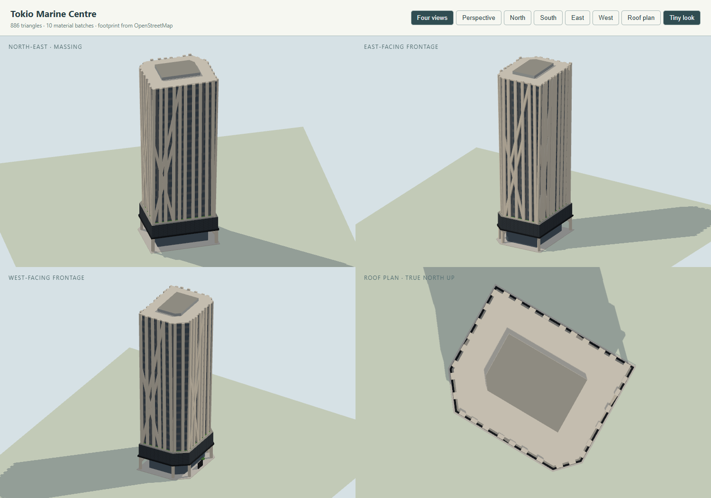

# Tokio Marine Centre model

Checklist **SG-083**. Program: `js/landmark-models/tokio-marine-centre.js`; tests: `tests/landmark-tokio-marine-centre.test.cjs`. Built on 4 November 2026 with the landmark kit and the city's normal/Tiny material pairing.

Tokio Marine Centre at 20 McCallum Street (Chan Sau Yan Associates; structural engineers Web Structures, now Ramboll; built by Shimizu; opened October 2010) is Tokio Marine's Asia headquarters. The office slab stands on giant concrete stilts over an open, landscaped ground-floor concourse; a dark base band holding the third-storey mechanised carpark and sky terrace overhangs it. The floors above are wrapped in the building's signature: a fair-faced concrete exoskeleton of bundled near-vertical columns and long diagonals — a "bamboo grove" — standing proud of recessed dark glazing, shading it. The floor plates grow as they rise, so the slab flares gently toward the top, where some columns overshoot the parapet.

## References and interpretation

- [CTBUH Skyscraper Center](https://www.skyscrapercenter.com/building/tokio-marine-centre/14703): 20 McCallum Street, office, completed 2011, 21 floors above ground, **124.5 m** architectural height, Chan Sau Yan Associates. Its photographs show the exoskeleton, the dark base band, the stilted concourse, the ground-level "TOKIO / MARINE / CENTRE" screen — and no crown signage.
- [Ramboll project page](https://www.ramboll.com/en-apac/projects/government-and-public/tokio-marine-hq-singapore) and its hero photograph (viewed directly): wide pale blades rising many floors, crossing in X and Λ figures, tips overshooting the roofline, near-black glazing with a thin slab line a floor behind them.
- [Doka reference](https://www.doka.com/ea/references/show/33564): structural height **121.50 m** — taken here as the roof slab under the 124.5 m architectural top (plant and column tips). No single source states both figures; the split is an inference, recorded as such.
- [Archnet](https://www.archnet.org/sites/6999?media_content_id=79781) and the [President's Design Award citation](https://pda.designsingapore.org/award-recipients/2011/chan-sau-yan-sonny/): the high-ceilinged public concourse and urban garden at street level; the "seemingly random" bamboo-like columns as structure and sunscreen; floor plates enlarging with height (about 715 m² low to 925 m² high in a secondary daylight study — treated as an estimate, giving the model's flare).
- [BCA Construction Excellence Awards 2012 fact sheet](https://www.nas.gov.sg/archivesonline/data/data/pdfdoc/20120502001/fact_sheet_-_bca_construction_excellence_awards_2012.pdf): GFA about 14,674–14,964 m² on a site of about 1,310 m².

The reference photographs stay outside the repository.

### OpenStreetMap way replaced

| Way | Tags | Use |
| --- | --- | --- |
| [171995558](https://www.openstreetmap.org/way/171995558) | "Tokio Marine Centre", `building=yes`, 21 levels, `height=121`, 20 McCallum Street, `start_date=2011` | the only mapped object: a six-point hexagon (edges 45.6 / 32.2 / 31.0 / 27.0 / 12.4 / 8.5 m, area ≈1,637 m²). No `building:part` children, no relation, no roof tags |

The mapped polygon is bigger than the published site area (1,310 m²) and much bigger than any floor plate, so it evidently traces the enlarged upper plate and exoskeleton projection. The model therefore keeps the hexagon for placement and draws the glass plate inside it (3.4 m in at the foot, 1.4 m at the head), with the exoskeleton proud of the glass. Bounds tests keep every solid within 0.6 m of the outline (the paving's outset).

The neighbours remain the city's — several overlap the hexagon's bounding box, so nothing is hidden by proximity: 158 Cecil Street (171995560, sharing nodes), Far Eastern Bank Building (171995552), Wing On Life Building (171995555, SG-084), Bangkok Bank (171995559 and its tower part 326926561), The Clift (171995553 and part 326926550), and the Stanley Street shophouses.

## Frame and drawing

The program works on the mapped hexagon directly. Stilts stand 2.4 m in from each vertex; exoskeleton stations walk each ring edge at irregular 3.4–5.6 m spacing (a deterministic hash), their centreline following the glass flare (`3.4 → 1.4` m inset between 20 m and 121.5 m, members 0.55 m proud of the glass line). Zone heights below the tower are photographic estimates; the tops are documented.

| Mass | Heights (m) | Basis |
| --- | --- | --- |
| Open concourse: stilts (1.7 m square) at the six vertices, three branching beams, round planters; recessed glass lobby (ring inset 6 m) | 0–11.1 (lobby to 8.5) | photographs; published concourse |
| Canopy slab (ring inset 0.2, projecting past the band) | 10.2–11.2 | photographs, estimated |
| Dark base band (ring inset 0.8): louvred carpark/terrace levels | 11–20 | photographs, estimated |
| Sky terrace ledge (ring inset 2.5, planted top) | 20–20.5 | published sky terrace |
| Office tower: flared dark glass, 18 painted floor bands at 5.64 m | 20–121.5 | Doka 121.50 m; band count from photographs |
| Exoskeleton: ~36 uprights (1.9 m wide blades) leaning with the flare, overshooting 0.5–1.8 m; 12 long diagonals in X and rising pairs | 20–123.3 | Ramboll/CTBUH photographs |
| Roof rim and plant (ring inset 10) | 121.5–122.3; plant to 124.5 | CTBUH 124.5 m |

Published floors are 21 above ground (OSM, CTBUH); CSYA and Doka say 24. The model paints 18 office bands over the concourse and two base levels — 21 levels in all — and treats the "24" as counting mezzanine, basement or roof levels.

## Palette and signs

From the photographs: fair-faced concrete `#c6c0b2` (stilts, branches, exoskeleton, rim), near-black glazing `#1b2126` in a muted grey frame `#595f64`, lobby glass `#2a343a`, the base band and canopy near-black (`#232629` louvres over `#0f1214`, canopy `#191c1f`), planted green on the terrace and concourse planters. The only sign is the ground-level screen at the McCallum Street entrance: white "TOKIO / MARINE / CENTRE" stacked on a dark panel 0.3–4.8 m up, as photographed. No crown sign exists, so none is modelled.

## Collision

- On the ground: the six stilts, the lobby (outline-filled), the sign panel. The concourse between them stays open and is probed in the tests.
- Explicit volumes: canopy slab and base band (10.2–20 m); the tower in three steps inside the flare (insets 3.4 / 2.7 / 2.0 at 20–55 / 55–90 / 90–121.5 m, each kept inside the glass at its heights); the roof rim and plant. The exoskeleton members are beams proud of the collided glass and carry no collision of their own.



## Inspect and rebuild

```text
http://127.0.0.1:8012/tools/landmark-preview.html?model=tokio-marine-centre&view=all
http://127.0.0.1:8012/tools/landmark-preview.html?model=tokio-marine-centre&view=ne&look=day
http://127.0.0.1:8012/tools/landmark-preview.html?model=tokio-marine-centre&view=ne&backend=webgpu
http://127.0.0.1:8012/?look=tiny&at=tokio-marine-centre&camera=map
```

```powershell
node --max-old-space-size=8192 tools/city/build.mjs singapore
node --test tests/landmark-tokio-marine-centre.test.cjs
```

## Verification

- `node --test tests/landmark-tokio-marine-centre.test.cjs`: 5 of 5 pass — the single replaced way with all six neighbours kept; 124.5 m within the mapped outline; stilts carrying the base band with the concourse open and walkable between them (probed 4 m inside the long north edge) and solid over it; the tower solid at 40/80/115 m; at least 24 uprights and 8 many-floor diagonals, some uprights overshooting the parapet; the one street-level sign; budgets, finite geometry, no flicker.
- 886 triangles in 10 material batches, 67 parts.
- Targeted suite: 157 of 157 pass. Full `node --test` on Windows: 648 of 656; the 8 failures (7 Overpass shell fixtures, 1 tile worker) fail identically on the untouched base.
- Rendered headless (Chrome): four-view Tiny, day-look north-east and WebGPU previews render without errors and were compared with the Ramboll and CTBUH photographs — the first version's light punched-grid glass was replaced with the near-black glazing and the columns widened after that comparison.
- Checked in the live city on 4 November 2026 (`/?look=tiny&at=tokio-marine-centre&camera=map`, WebGPU, after the overlay cleared): the lattice-wrapped slab stands over McCallum Street between Wing On Life Building and The Clift, all neighbours present, no duplicate generic solid. [City view](images/tokio-marine-centre-city.png). (One capture attempt showed six unrelated model imports refused by the single-threaded local test server under parallel load; a repeat run loaded every model cleanly.)

## Limitations

- The exoskeleton's exact pattern is invented within the photographed rules (irregular bundled uprights, long diagonals); the real members taper, pair and merge in Λ figures that vary face by face.
- Uprights begin at the base band's roof (20 m); in the building they continue through the band to the stilts. The band's dark face hides the join at map distance.
- The plate flare (+29% area low to high) rests on a secondary study's floor areas; the mapped hexagon is treated as the upper plate's projection, not a surveyed plan.
- Concourse and base-band heights, the lobby's extent and the sign panel's exact position are photographic estimates; the 124.5/121.5 m split between architectural top and roof slab is an inference (above).
- The rooftop garden is represented only by the rim and plant; no roof plan was found.
