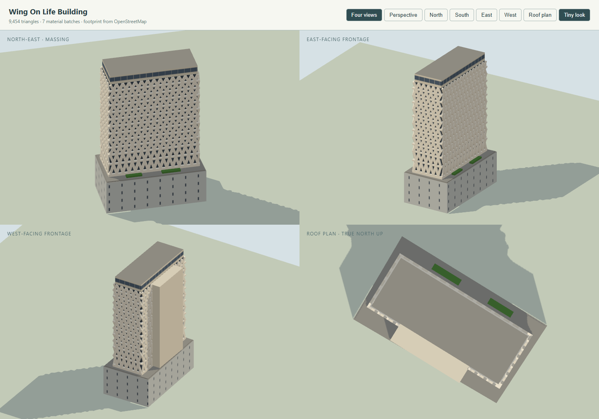

# Wing On Life Building model

Checklist **SG-084**. Program: `js/landmark-models/wing-on-life-building.js`; tests: `tests/landmark-wing-on-life-building.test.cjs`. Built on 4 November 2026 with the landmark kit and the city's normal/Tiny material pairing.

The Wing On Life Building at **150 Cecil Street** (not Shenton Way, its larger neighbour's address) was designed by James Ferrie & Partners (architect-in-charge Theresa Chee) for Wing On Life Assurance and completed in 1975 — renamed AXA Life Building in the mid-1990s and now marketed simply as "150 Cecil Street". It is Singapore's full-height twisted-fin building: a slender office slab whose every floor is wrapped in precast "peripheral hyperbolic structural mullions" — twisted concrete fins, alternately arranged to form diamond-shaped openings that shade the full-height windows behind them. The slab sits inset over a near-blind tiled podium (banking hall, mezzanine and two floors, its loads transferred to six columns at the fourth floor), with a plain service core on its rear face and the former split-level penthouse — now offices — as a blank crown band. Docomomo Singapore lists it as Not Conserved and at redevelopment risk.

## References and interpretation

- [Docomomo Singapore, Modernist 100: Wing On Life Building](https://docomomo-singapore.squarespace.com/modernist-100/wing-on-life-building): architect, client and 1975 completion; the 20-storey tower-on-podium composition; podium of ground + mezzanine + two upper floors with slit-like openings to Cecil Street, an internal garden court and a podium roof garden; fin loads transferring to six columns at the 4th floor; the split-level penthouse (garden terrace and pool, since converted to offices); the hyperbolic fin system on 12 floors. Its 2016 hero photograph and fin close-up are primary references.
- [Corporate Locations leasing page and elevation photograph](https://www.corporatelocations.com.sg/office-for-rent/building/108/150-Cecil-Street/) (photograph viewed directly): the Cecil Street face straight on — twelve finned bands (the lowest two taller and more splayed), wide tapered blades a deep shadow's width in front of near-black glass, strongly projecting slab edges, the blank crown with one ribbon window, the blank end above the fins, and the grey tiled podium with its plain cornice. Its floorplan shows the lifts, stairs and services in one core bar on a long side.
- [estate.sg summary](https://www.estate.sg/about-150-cecil-street.html): typical plate about 4,200 sq ft (≈390 m²), full-height windows behind the fins, column-free floors.

No CTBUH, SkyscraperPage or Emporis entry was found; the only published height is OSM's 56 m. The reference photographs stay outside the repository.

### OpenStreetMap way replaced

| Way | Tags | Use |
| --- | --- | --- |
| [171995555](https://www.openstreetmap.org/way/171995555) | "Wing On Life Building", `building=yes`, 20 levels, `height=56`, `start_date=1973`, 150 Cecil Street | the only mapped object: a quad of edges 20.5 / 37.8 / 21.3 / 36.7 m (area ≈782 m²), long axis along Cecil Street. No `building:part`, roof, colour or material tags; no relation references it, and no part way overlaps it |

The quad is the **site/podium outline, not the tower plate**: at 782 m² it is twice the published ~390 m² typical plate. The podium is therefore drawn over the whole quad and the finned slab inset within it (33 × 12.5 m ≈ 412 m² gross). The quad shares its long edges with Far Eastern Bank Building (171995552, south-west) and Solitaire on Cecil (171995562, north-east); both remain the city's, and the tests keep every modelled solid within 0.35 m of the outline so nothing steps over the shared edges. Also kept: 158 Cecil Street (171995560) and Tokio Marine Centre (171995558, SG-083).

## Frame and drawing

The program recovers a local frame from the quad's longest edge (`u` along Cecil Street, `v` across, origin at the vertex average) and works out which side faces Cecil Street from `kit.compass(50)`; the core bar goes on the other (south-west) face. Heights split the mapped 56 m by the photographed bands — the splits are visual estimates; the total is mapped.

| Mass | Heights (m) | Basis |
| --- | --- | --- |
| Podium over the full quad, slit openings; roof deck and two planters | 0–13 (deck 13–13.3) | published podium makeup; height estimated |
| Transfer slab (34.4 × 13.9, cantilevering past the slab) | 13.3–13.8 | the six-column transfer, published |
| Finned slab: dark glass 33 × 12.5, twelve slab edges standing 0.75 proud, ~720 diagonal blades in W zigzags flipped band by band (lowest two bands 4.5 and 4.0 tall, then ten at 3.02) | 13.8–52.5 | Docomomo's 12 finned floors; module ~2.36 m (14 diamonds a long face, 5 an end) from the photographs |
| Rear service core (18 × 4.6 on the south-west face; fin blades omitted behind it) | 13.8–52.44 | leasing floorplan |
| Blank crown with one ribbon window | 52.5–56 | photographs; total is the mapped 56 m |

The "20 storeys" of OSM and the leasing agents counts the mezzanine and split penthouse levels; the exterior shows 17 bands (podium levels within the 13 m, 12 finned, 1 crown), and 17 bands at these heights reconcile with 56 m. OSM's `start_date=1973` is presumably the construction start; Docomomo's 1975 completion is used here (leasing agents' "1980" appears to be wrong).

## Palette and signs

Photo-sampled estimates: warm off-white precast fins and slabs `#e6dfcc`; crown and core weathered cream-grey `#d8d0ba`; recessed glass near-black `#141a1e` in dark frames; podium pale grey tile `#c2c5bf` with sparse dark slits; muted green planting on the terrace. There is no signage on the tower or crown in the 2016 Docomomo photograph or the current leasing elevation, so none is modelled — the tests assert this.

## Collision

- The podium (automatic, to 13 m) and the transfer slab (explicit, 13.3–13.8 m).
- The office slab as one explicit volume over its glass footprint, 13.8–56 m (the fins and slab edges stand proud of it by up to 0.75 m and carry no collision of their own).
- The podium roof terrace around the slab is left open and probed in the tests (solid at its deck, free above).



## Inspect and rebuild

```text
http://127.0.0.1:8012/tools/landmark-preview.html?model=wing-on-life-building&view=all
http://127.0.0.1:8012/tools/landmark-preview.html?model=wing-on-life-building&view=ne&look=day
http://127.0.0.1:8012/tools/landmark-preview.html?model=wing-on-life-building&view=ne&backend=webgpu
http://127.0.0.1:8012/?look=tiny&at=wing-on-life-building&camera=map
```

```powershell
node --max-old-space-size=8192 tools/city/build.mjs singapore
node --test tests/landmark-wing-on-life-building.test.cjs
```

## Verification

- `node --test tests/landmark-wing-on-life-building.test.cjs`: 5 of 5 pass — the single replaced way with both edge-sharing neighbours kept; the mapped 56 m with every solid inside the outline; the podium terrace probed toward its north-west corner (deck solid, air open, tower clear of it); twelve slab edges and at least 500 diagonal blades kept to the finned bands; no sign; budgets, finite geometry, no flicker.
- 9,454 triangles in 7 material batches, 788 parts (mostly fin blades).
- Targeted suite: 157 of 157 pass. Full `node --test` on Windows: 648 of 656; the 8 failures (7 Overpass shell fixtures, 1 tile worker) fail identically on the untouched base.
- Rendered headless (Chrome): four-view Tiny, day-look north-east and WebGPU previews render without errors and were compared with the Docomomo and leasing photographs — the blades were widened and the slab edges deepened after the first comparison, where the lattice read too fine, and the podium's slits thinned out.
- Checked in the live city on 4 November 2026 (`/?look=tiny&at=wing-on-life-building&camera=map&yaw=217&dist=240`, WebGPU, after the overlay cleared; the flipped yaw looks from the north-west because Tokio Marine Centre otherwise stands in front): the cream finned slab sits between Far Eastern Bank Building and the Stanley Street shophouses, all neighbours standing, no duplicate generic solid. [City view](images/wing-on-life-building-city.png). The console showed no landmark errors or flicker warnings.

## Limitations

- The fins are straight diagonal blades in a W zigzag; the real blades are tapered hyperbolic twists. The diamond read at map distance is the same; at arm's length it is not.
- The mapped 56 m is OSM-only and low-confidence (the same "56" is reused on neighbouring ways), and the band heights splitting it are estimates. The slab's 33 × 12.5 m plate is derived from the published ~390 m² floor area, not surveyed; its exact position on the podium follows the quad's centre.
- The podium's internal garden court and banking hall are not modelled (the podium is a solid with slit openings, as it reads from the street); the former penthouse pool is omitted, as it no longer exists.
- The glass behind the lattice is painted facade, not individual panes; the crown's ribbon runs on all faces (the photographs show it full-width on Cecil Street and shorter on the end).
